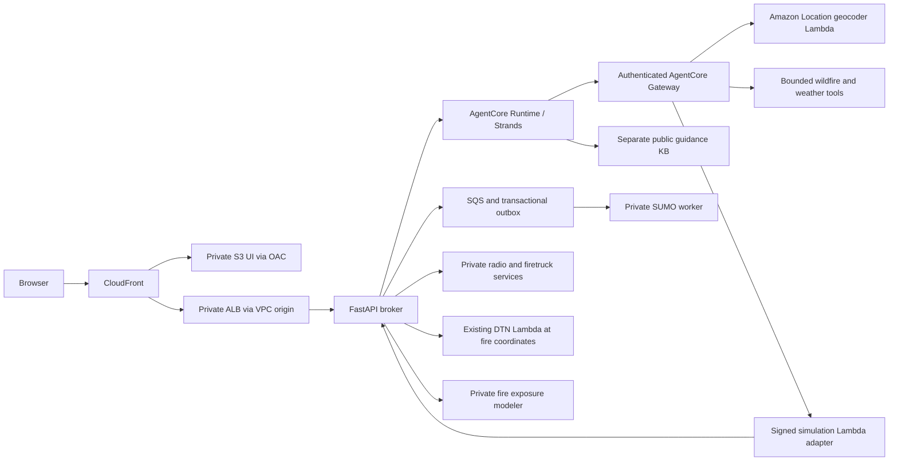

# Current FireGUard implementation

This document describes implemented behavior and owns the list of [known limits and backlog](#known-limits-and-backlog). Each release's test results and acceptance receipts are in its release folder ([workspace operations](29-workspace-operations.md#state-evidence-and-retries)).

[Fire exposure implementation](48-fire-exposure-implementation.md) describes the fire exposure design, including its
source-bound terrain and road preparation.

## User experiences

| Experience | Implemented behavior | Limits |
|---|---|---|
| Investigation | A same-origin broker invokes the AgentCore supervisor. Detection resolves an address with Amazon Location, searches the public wildfire feed, and retrieves DTN weather. Response retrieves a separate public guidance collection. | Radio is prerecorded; a scenario does not require an active fire. Geocoding is address → coordinates, not reverse geocoding. A match score is not a probability. |
| Evacuation & Crew Access — Guided | Radio or reference place → verified location → parallel nearby-fire/weather/forecast/guidance investigation and road preparation → reviewed draft → explicit SUMO submission → simulation-informed plan. Separate initial and updated plans retain their evidence. | Historical names identify locations, not reconstructions or active fires. Custom/radio locations default to 4 km, Paradise to 8 km and Palisades to 6 km. Interrupted agent work requires explicit retry. |
| Map and evidence | Shared maps show reported nearby fires and weather details alongside roads, modeled exits, crew trails and traffic. Undock into the viewport, restore with Escape, select policy at the same replay time, seek, compare outcomes and inspect sources. Selection, investigation receipts and answered-run evidence survive reload. | Model exits are not verified safety; crews reach simulated staging, not suppression. Missing results remain unavailable. Observations do not recalibrate hazard growth. |
| Fire exposure | New Investigation answers reference an owned background job at each reported fire point. Aligned LANDFIRE fuel/elevation and measured DTN wind drive native Pyrothermel/Behave cell-arrival footprints; the map reads saved geometry and frames the selected footprint. | U.S. CONUS/Alaska/Hawaii products; explicit moisture/open-fuel assumptions. Historical context is optional. No burn probability, active-front forecast or operational arrival claim; this layer does not change SUMO hazards. |
| Evacuation & Crew Access — Research | Former Traffic Lab: bounded coordinate/highway discovery, scenario editing, current sources, asynchronous SUMO jobs, history, shared replay/evidence and exports. Workflows preserve their state when switched; two worker tasks execute whole scenarios concurrently. | Enabled through anonymous workspace configuration; synthetic demand/hazard assumptions remain explicit. Owner/global admission limits apply to both modes together. |
| Response Tracker | Step 3 replays the selected stage-2 SUMO run and policy, with crew role labels and illustrative resource numbers that are never sent to agents or saved (D50). A standalone firetruck exercise, opened from step 3, exposes synthetic suppression stages and telemetry through owned broker routes; stop retains evidence, and a no-tool report specialist writes a report from signed saved evidence. | The replay adds no simulation. The exercise is a separate synthetic model, not real dispatch, equipment telemetry or measured fire suppression. |

## Execution and agent flow

The public investigation supervisor registers detection and public response tools, and communication when the visitor explicitly asks for it: a reviewable draft with English, Spanish and Hindi recordings, never sent as an alert ([communication](02-multi-agent-orchestration.md#communication-and-evidence-presentation)). Unrestricted report tools are not registered. Simulation requests select the simulation specialist directly in the same Runtime, avoiding a routing-only supervisor turn. Suppression reports select a separate no-tool specialist. Source retrieval is a local Strands tool using IAM `bedrock:Retrieve`; it does not need a Gateway target. Gateway exposes provider adapters and the five simulation operations.

The model-visible simulation tools are prepare, submit, status, evidence and create variant. Their JSON schemas are generated from the workspace API contracts (`scripts/export_integration_contracts.py`). New scenarios accept civilian vehicle count, departure window and an optional 2–15 km study radius. Frozen-input variants expose only vehicle count and departure window; changing geography requires a new preparation. Contraflow, wind-driven spread, crew-count changes, hazard edits, injury estimates and real road-control actions are not supported agent capabilities. A proposed variant becomes a reviewable draft; a user request explicitly authorizes submission. Tool effects carry signed owner/session/incident/operation context that is hidden from the model.

Strands native structured output validates final response schemas. Investigation and simulation share the AG-UI reader, requiring both a final state snapshot and successful terminal event; simulation additionally checks the requested session, incident and location revision. Saved updated plans render retained resident/crew facts, paired comparisons and source gaps outside generation. Public procedural text uses agent-selected passages verified against actual retrieved text and cannot be rewritten by the supervisor. Passage support does not establish relevance, local applicability or operational safety. Open evaluation work is listed under [known limits and backlog](#known-limits-and-backlog).

## Components and contract authority

| Component | Responsibility | Contract authority |
|---|---|---|
| UI evacuation workspace | Review drafts, select run/policy/replay, ask questions and render evidence | Generated workspace contracts and validated artifact data |
| Workspace API | Ownership, revisions, admission, idempotency, preparation and evidence | `backend/evacuation/contracts.py`, `service.py`, `evidence.py` |
| Fire exposure modeler | Bounded terrain/fuel-dependent native surface-fire calculations; historical contracts retained | Pure `fire_risk_modeler/models.py`; independent calculator/service package |
| SUMO worker | Network/source capture, seeded demand, policy execution, frozen bundles and publication | `traffic_simulator/models.py`, `input_bundles.py`, `worker.py` |
| Runtime specialist | Bounded reasoning and supported UI actions | `agents/simulation_agent/` and generated `tool-inputs.json` |
| Gateway Lambda | Forward fixed operation payload and hidden context | Fixed `payload`/`trusted_context` transport envelope |
| Deployment | Private routing, IAM, configuration, build and release receipts | `deployment/installation.py`, `settings.toml`, CDK and backend templates |

Keep deterministic business calculations in the service and engine. Prompts and Gateway adapters do not implement metrics, authorize operations or manufacture receipts.

## Source and model boundaries

Amazon Location is the shared IAM forward-geocoding service for investigation, radio and presets. Radio requires an unambiguous California address/intersection with score ≥90; place presets permit representative locality/POI matches. Results use `IntendedUse=Storage`. ArcGIS map components and public wildfire/Caltrans feeds remain; no Esri geocoding key is needed.

OSM supplies the bounded U.S. road network and corridor discovery for new scenarios.
Preparation chooses a usable corridor from the same snapshot converted by SUMO.
Address, locality, coordinate and retained reported-fire inputs preserve their
location provenance. Synthetic traffic is the default; explicitly selected TomTom
speed samples constrain matched road speeds. Caltrans is optional California
traffic/closure/camera context and does not gate preparation outside California.
NWS provides simulation weather context; DTN serves agent weather requests and
bounded API enrichment at reported fire coordinates. Optional FIRMS detections are
context. PeMS ingestion is not implemented. Source unavailability, timestamp/coverage
gaps and unmatched roads remain explicit. Sources do not automatically calibrate
demand or transform the SUMO circular hazard into a fire forecast.

Each run freezes source snapshots, network, traffic matching, seeded demand and model assumptions. Controlled variants reuse that bundle. Residents exiting, still on roads and not departed must balance requested demand. Show waiting, exposure, unresolved demand and crew nonarrivals alongside timing among matching arrivals. UI units are U.S.; APIs and stored model artifacts retain documented SI units.

A background preparation job validates the roads before a draft becomes ready. Oversized networks can produce a smaller extent for explicit review, with the original limits retained. New scenarios accept an optional radius; frozen-parent variants retain their original geography. See [background road preparation](32-traffic-simulator-architecture.md#background-road-preparation).

Public SOP content is a reviewed collection of official **guidance**, not a locally adopted SOP or current order. It contains 10 complete text sections from FEMA Ready.gov, NPS and the Forest Service, with official URLs, dates when stated, snapshot hashes and exact text hashes. There is no private KB fallback. See [PUBLIC_SOP_COLLECTION.md](28-public-sop-collection.md).

## Security and operations

The browser contains no AWS keys or provider secrets and makes agent requests through the same-origin broker. Anonymous visitors receive an opaque Secure/HttpOnly/SameSite cookie. The broker checks owned resources, action scope, payload bounds and admission limits. ECS services have private addresses; CloudFront uses an internal ALB/VPC origin with WAF. AgentCore Runtime requires IAM and Gateway requires authenticated service access. Credentials remain server-side. The Runtime reads its Gateway secret by ARN; the DTN Lambda reads its credentials by ARN, and TomTom and FIRMS are injected into private task configuration; the [credential rotation runbook](45-credential-rotation-runbook.md) covers replacing and revoking every key.

`bash deployment/deploy-all.sh` checks and plans an installation, and `--apply` deploys or updates it in place; [workspace operations](29-workspace-operations.md) is the procedure.

The hourly artifact collector removes aged orphaned run/report objects after consistent metadata absence checks; referenced inputs and original recordings remain preserved. Reviewed container CVEs are not all patched; a reachability review is not remediation. Automated naming/isolation tests are not a fresh-account deployment certificate.

## Known limits and backlog

- Execution and citation checks do not establish every narrative interpretation. Semantic faithfulness and subject coverage stay open (the A02 row); do not present generated guidance as operational orders or universally verified advice.
- A guardrail refusal before any tool activity shows as a generic investigation error: the visitor sees "Investigation could not complete. Please retry." The published guardrail's prompt-attack filter (input strength HIGH) also refuses some planning questions that are not attacks, at LOW confidence. It refused the public SOP check's former question: "Use the public guidance collection for this planning exercise. Give two brief considerations for household evacuation routes and transport preparation, and two for firefighter escape routes, safety zones and crew communications. Keep the answer under 250 words. Cite the official publications. Distinguish guidance from incident orders. There is no active incident to investigate." The check now asks it without the last sentence, which the guardrail passes, and the deployer's real-model check sends the same question before each update of a demo with public guidance ([what the deployment does](29-workspace-operations.md#what-the-deployment-does)). Keep the guardrail and the failed receipt; do not loosen the guardrail or count structural checks as coverage. A clearer refusal message stays in the A02 backlog (owner, 2026-10-20).
- The rate limits and budgets (`rate_limits.*`, `budgets.agent_requests_per_day`, `capacity.active_jobs_all_visitors`, `capacity.investigations_per_api_process`, in the [settings table](29-workspace-operations.md#operational-settings)) bound cost; they are not simultaneous-user or throughput guarantees. A radio, initial-plan and updated-plan flow uses about three AI starts, and cancellation holds capacity until the work stops.
- Fire reports can be delayed or incomplete, and distance bands are illustrative. SUMO hazard and demand are synthetic; weather is context, not a spread model. Saved receipts survive a browser disconnect, but API process loss interrupts an investigation and needs a retry; queued simulation is durable.
- Services update in place, and rollback covers only the Runtime binding (D51).

| Backlog | Trigger / priority | Smallest next step and acceptance |
|---|---|---|
| Expo load and recovery rehearsal (A08) | Before an attendee expo, P1 | The maintained 20-visitor/two-investigation rehearsal (`deployment.acceptance.rehearse_expo`) has passed on an earlier Runtime; the current Runtime has not been attendance-rehearsed. Rehearse the actual venue network and process loss separately; tune budgets from measured demand. |
| SUMO road/seed robustness and failed-run diagnostics | Before generalizing comparisons, P2 | Replay retained seed `1791169614` on its frozen roads and inspect the coordinated-policy junction collision. Measure failures across matched seeds/demand and review road geometry before changing behavior. Preserve invalid-result rejection; do not disable collision checks or retry until a seed passes. |
| Vendor image fixes / scanning coverage (A04) | Before the exceptions expire on December 14, P1 | Refresh supported packages/bases, rerun native decode/SUMO/ARM64 gates and exact-image scans. Reassess each retained exception ([exception re-review](36-public-demo-security.md#exception-re-review)); consider repository-scoped Inspector coverage with cost review. |
| Test-client dependency deprecations | Next supported lock refresh, P2 | Starlette warns about its `httpx` test-client compatibility path and deprecated AnyIO portal alias. Upgrade the compatible test stack together and rerun transport tests; do not edit vendor files or suppress warnings to imply a fix. |
| Portable browser fixture/runtime (A03) | CI or another developer workstation, P2 | Make the retained SUMO fixture and supported Playwright/browser installation reproducible; keep explicit provider mocks and real artifact provenance. |
| Nondefault release configurations | Before another installation is supported, P2 | Exercise full acceptance with disabled optional features. Make required acceptance match explicitly selected capabilities without hiding failures. Quality/live gates use the selected deployer interpreter, which needs development dependencies. |
| Separate staging and atomic promotion (A03) | Public uptime or repeatable releases require isolation, P2 | Deferred by D51. When triggered, extend the existing IaC with isolated candidate state, immutable artifact promotion and verified rollback. |
| Component/native build reuse and later-phase resume (A05) | Measured build time or interruption cost warrants it, P2 | Preparation-only recovery is implemented. Add Runtime-build/activation recovery only with exact AWS/source/build identity and no duplicate pushes. First use supported CodeBuild caching; require complete platform/base/lock/native identity and current verification. Measure repeated UI asset uploads before optimizing them; keep verified bytes and index-last publication. |
| Investigation settings cleanup (A06) | Next change to operational limits, P2 | Put adjustable deadline/concurrency limits in the settings contract; keep hard protocol ceilings. The investigation turn's 128 KiB context ceiling is still written three times as a literal in `agent_broker.py`; name it once, as `incident_investigation.py` names the updated plan's 192 KiB `MAX_PLANNING_CONTEXT_BYTES`. |
| Multi-topic guidance coverage, semantic faithfulness and rejection messaging (A02) | Final displayed prose review, P1 | Evaluate temporal wording, zero-record versus no-fire statements, final counts versus dispatch timing, and household/crew coverage. Keep the negative cases: an updated plan that suggested EAS/WEA enrollment although its cited source says no signup is needed; an answer that called unconfigured PeMS "zero records" (the facts say `not_configured`); an answer that confused people and vehicles. A planning prompt that hit the guardrail before tool activity showed a generic error; keep enforcement and improve the refusal message. Exact facts, passage identity and drawer integrity do not establish interpretation faithfulness. |
| Direct-mode features behind the broker | Done, 2026-10-19 | Removed 2026-10-19 (owner): the Radio Monitor console, the camera direct client, the firetruck direct API and the older radio broker fallback were deleted. Still deferred as structural work: the firetruck package rename (W3.1) and the split and move of `ResponseDashboardPanel` (UISH-6). |
| Compact plan lineage (A09) | Comparing model/prompt/corpus changes, P2 | Save release/model/prompt/corpus identity with existing receipts; avoid a new telemetry service. |
| Durable agent execution | Demonstrated need for recovery across API process loss | Reuse the existing job pattern only when manual retry is insufficient; no new queue for the current demo. |
| Capacity telemetry/autoscaling | Measured demand and quota/cost headroom | Add the missing signal first, then tune existing services. Do not infer attendee capacity from worker count. |
| Account separation (guidance decision 13) | Before anything sensitive is hosted or another team shares the account, P3 | A dedicated account is the strongest boundary (SEC01-BP01); do not share the installation's account with unrelated workloads. Next step: deploy a new installation with its own `[aws] account_id` and name, move the demo, then retire the old one. Recorded, not started. |
| Retained `ReportImagesBucket` (RTGW-2 step 2) | Owner decision, P3 | The empty, versioned bucket, its TLS-only policy, its outputs and the unused stack-4 `ReportImagesBucketName` parameter stay. W2.11 deferred their removal because `change_sets.stateful_risks` stops any Remove of an `AWS::S3::Bucket` whatever its `DeletionPolicy`, so the backend release would stop (D24). Next step: the owner chooses between a guard rule for Retain removals, with its test, and manual retirement after preservation. |
| Unread FIRMS copy in the backend `APIKeysSecret` | Owner decision, P3 | Nothing reads its `NASA_FIRMS_API_KEY` since W2.11 removed the NWS weather Lambda; the API and SUMO worker read FIRMS as `FIRMS_MAP_KEY` from the application's provider secret. Since L2 (D53) the DTN weather Lambda's role may read this whole secret, so code running in that function could read the copy too, a further reason to drop it. W2.11 keeps the copy by default, pending the owner's phase 5 go. Dropping it is an in-place `SecretString` change that stops for review and passes with `--acknowledge '<backend stack>/InfrastructureStack/APIKeysSecret=AWS::SecretsManager::Secret:SecretString'`. |
| Live acceptance needs a TomTom highway reading | Before a release must not depend on one provider, P2 | Live acceptance's SUMO run requires TomTom to report a high-confidence segment on the selected highway, and that check has no fallback; the fire lookup falls back to the nearest usable NIFC incident. A release can stop when TomTom has no such segment. |
| Split injections (phase 2 S4-R) | P3 | Each string field of one record is its own `guardContent` block, so fragments that are each harmless are assessed apart. Next step: one joined `ApplyGuardrail` call before each specialist call, failing closed. |
| Hindi on the guardrail's Classic tier (phase 2 H1) | Owner decision, P3 | The Classic tier does not cover Hindi; a Devanagari injection passed it. The Standard tier covers Hindi but changes the published guardrail and needs cross-Region inference, so the tier is the owner's decision. |
| Tool results and system prompts (phase 2 S5) | P3 | Guardrails never assess tool results, and retained fire names sit in system prompts. Next step: an `AfterToolCallEvent` hook that calls `ApplyGuardrail` on tool results and fails closed. |
| Phase 6 follow-up that needs `ui/src` | P3 | The browser harness's exercise-fit wait in `ui/scripts/browser/exercise.cjs` (`stableMap`) is still a 600 ms window, because the page exposes no map-fit state; add an app-side signal while `useMapCentering` fits, then wait on it. |
| DEPL-8 step 2 and RTGW-11 step 2 | After their step 1 (deferred below), P3 | Each changes an interface that only a deploy can prove: CloudFormation parameters for DEPL-8, and the AG-UI event stream with a live trace for RTGW-11. |
| UIWS-3: split `EvacuationWorkspace.tsx` | Owner deferred 2026-10-16: structural, no behavior change | Extract `IncidentContextPanel`, one `restoreRun` and a `useGuidedSession` reducer, compose stage 3 from the hook and rename the file `GuidedWorkspace.tsx`, keeping the restore order, the search-area gate and one kept-mounted instance. |
| UIWS-6: move the evacuation domain into one folder | Owner deferred 2026-10-16: structural, no behavior change | Move artifacts, replay, units, mission and congestion into a `domain` folder of the evacuation feature with an `index.ts`, have Traffic Lab import through it, and copy that one folder into the API image's ui-metrics stage. |
| DEPL-8 step 1: split the application stack constructor | Owner deferred 2026-10-16: structural, no behavior change | Move the builders out of `deployment/infra/lib/stacks.ts` into one module per area, called with the stack as scope and the same construct IDs, so synth stays byte-identical. |
| RTGW-11 step 1: split the investigation turn | Owner deferred 2026-10-16: structural, no behavior change | Introduce an `InvestigationTurn` dataclass with `_verify_turn`, `_build_turn_agent` and `_final_payload` in `wfm_agui_entrypoint.py`, keeping the patch targets and the event stream unchanged. |
| TSIM-7: one `PreparedNetwork` type | Owner deferred 2026-10-16: structural, no behavior change | Return a `PreparedNetwork` NamedTuple from every network producer, including the freeze and thaw path, and extract `build_grid` from `testing.grid`. |
| TSIM-14: split the simulation engine loop | Owner deferred 2026-10-16: structural, no behavior change | Extract `_start_engine`, `_configure_engine`, `_submit_civilians` and `_PolicyRun.step/summary` with named constants, keeping the RNG and TraCI order. It changes MODEL_CODE, so identical-run reuse resets once. |
| TSIM-15: split the worker's job execution | Owner deferred 2026-10-16: structural, no behavior change | Introduce a `JobContext` and five helpers, keeping the claim, heartbeat, exception mapping order, fenced writes, lease and cleanup. It changes MODEL_CODE, so identical-run reuse resets once. |

### Common structure for extensions

| Layer | Rule |
|---|---|
| Domain/model/evidence | Deterministic logic and typed versioned values; no HTTP or AWS calls in calculations. |
| Application service | Own authorization, revisions, admission, idempotency and orchestration. |
| Inbound adapter | Validate transport, obtain verified identity and translate service results/errors. |
| Outbound adapter | Own provider/AWS/filesystem behavior, bounded waits, retries, sanitization and error normalization. |
| Composition/configuration | Validate explicit settings and construct only active dependencies. |
| UI feature | Typed API/state hooks and presentation through a small public interface. |
| Deployment | One installation flow, locked builds, private routing, least privilege and reviewable stateful updates. |

Keep deterministic evidence authoritative: resident and crew outcomes together, nonarrivals and unresolved demand, matched horizons, paired arrival subsets and explicit unavailable values. Avoid a speculative `utils` framework or abstract factory hierarchy; introduce an interface only when it removes a real dependency or supports the existing local/AWS alternatives.
