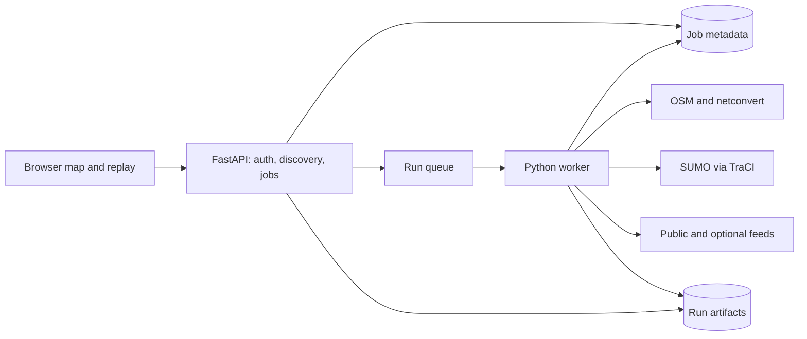

# Model and implementation

This is a research demonstrator. Its output must not direct an actual evacuation or dispatch. Software tests establish code behavior, not validity of a traffic model or wildfire forecast.

Settings named in this guide, such as `simulation.policy_parallelism`, are listed with their defaults, units and ranges in the [settings table](29-workspace-operations.md#operational-settings).

## Coordinate-to-simulation workflow

Evacuation & Crew Access contains Guided and Research modes. Both use the same worker, policies,
versioned artifacts and evidence components. Guided verifies an incident, prepares and reviews
a road network, records agent turns and creates controlled variants from frozen parent inputs.
Research retains the free-form coordinate/highway editor, assumption controls, source lookups,
run history, replay and exports. The former `traffic_run` links and remembered Traffic Lab tabs
open Research mode in the combined workspace. Switching modes pauses replay but preserves edits,
saved evidence and active jobs.

The worker ships headless SUMO 1.27.1 and Osmium 1.19.1 binaries from checksum-pinned source archives.
Osmium uses pinned libosmium 2.23.1 and protozero 1.8.1 headers; its CLI avoids a Python-version-specific native wheel.
Pinned Xerces 3.3.0 and PROJ 9.9.0 retain local XML and local azimuthal equidistant projection while excluding
native URL access, ICU, curl and TIFF grids. Provider HTTP remains in the Python adapters.
The Linux gate checks the actual executable paths, versions and dynamic libraries,
then runs real engine tests. API integration verification reuses that native artifact;
its runtime contains no SUMO. Native source pins and exact release identity live in
the Dockerfiles and release receipts; advisory coverage is described in
[supply chain and image gate](36-public-demo-security.md#supply-chain-and-image-gate).

`traffic-simulator/scripts/benchmark_osm.py` is the explicit regional resource/integration proof, parameterized by
latitude, longitude and radius. It captures one current canonical source, runs cold then warm preparation and actual
SUMO baseline accounting on identical seeded civilian/crew demand, and rejects changes in source, bounds, graph,
gates, demand or native outcomes. Its flushed phase/final JSON includes source hashes, CLI versions, timings, separate
process/largest-child RSS high-water marks and available Linux cgroup v1/v2 aggregate peak/limits. Owned scratch
content/allocated-file high-water marks are sampled every 0.1 seconds, explicitly excluding filesystem metadata and
between-sample changes. Filesystem capacity is reported separately; low observed usage does not prove an enforced
30 GiB quota. Local macOS measurements do not establish the Linux worker envelope; run this proof in the verified
image at the configured CPU/memory limits. Ordinary regression suites use offline fixtures and do not download a
regional source.

1. Choose a U.S. incident coordinate and 2–15 km radius, including locations in Alaska and Hawaii. Guided preparation queues automatic corridor selection; Research can inspect a bounded OSM shortlist and select a corridor explicitly.
2. Enter synthetic demand, crew count, departure window, horizon, seed and hazard assumptions. New Guided drafts default to synthetic traffic and keep corridor and exit direction pending until the worker validates them; Research can set an assumed exit direction.
3. Select publisher regions covering the actual bounds, resolve dated Geofabrik PBF files, and extract complete OSM roads and restriction members locally. Convert the directed network using SUMO `netconvert`, or reuse the area's cached network (see [road-network cache](#road-network-cache)). The corridor candidates and converted network come from the same OSM snapshot.
4. Match candidate roads to SUMO lanes through their original OSM way IDs and choose up to three outward-directed model gates. Guided preparation seals the resolved corridor and assumed direction before review. A reviewed run restores those exact roads before fetching current context.
5. Save available source observations, generate matched demand, and run the SUMO experiment for each selected policy, in parallel processes.
6. Replay vehicle frames, compare accounting and exposure, inspect source freshness, and export the run.

The public Traffic Lab view accepts user coordinates. The integrated FireGUard workspace additionally accepts U.S. address or place matches through the shared Amazon Location Lambda, explicit coordinates, and an owner-scoped selected fire observation. A place or coordinate is a scenario location assumption; a selected fire retains its provider identity and observation time. Prerecorded-radio addresses and Paradise/Palisades presets remain supported. No automatic fire-detection classifier is implemented. Model gates are assumed destinations, not verified refuges.

Local mode uses SQLite and a worker thread controlling separate SUMO processes, one per policy (see [parallel runs and policies](#parallel-runs-and-policies)). AWS uses DynamoDB, SQS, S3, and separate API/worker Fargate services. No simulation logic runs in the browser.

DynamoDB holds small coordination records: jobs, ownership, request receipts, revisions,
leases, admission counters and references to frozen artifacts. S3 holds the larger network,
replay and evidence files; SQS delivers work. Conditional leases and revision-checked
transactions let independent workers share this state without claiming or publishing the
same job concurrently.

The table and indexes are declared in `deployment/infra/lib/stacks.ts`; CDK synthesizes
CloudFormation and the installation flow reviews changes before applying them. Record
writes live in `traffic_simulator/store.py` and `persistence.py`, rather than a separate
table-creation script. Ordinary document fields do not need a table schema alteration.
Changes to existing records need an explicit migration in bounded, checkpointed pages;
scheduled outbox repair only queries the sparse pending index.

`STORAGE_MODE` selects the mode and is required (`local` or `aws`, no default); any other value stops the worker and the API at start-up. The local launcher (`backend/scripts/local_server.py`) and the test `conftest.py` files set `local`; both ECS tasks set `aws`, which also requires `AWS_REGION`, `ARTIFACT_BUCKET`, `JOBS_TABLE` and `QUEUE_URL`.

## Background road preparation

Guided preparation calls the REST draft endpoint directly, returns a `preparing` draft and queues a bounded road-validation job on the worker; it neither synchronously discovers a corridor, simulates policies nor fetches TomTom speeds. The preparation-only scenario carries `highway="auto"` and `exit_direction="auto"`; runnable scenarios require concrete values. Omitted radii request automatic road-aware planning, starting at a 4 km (2.49 mile) search extent within the configured maximum. Explicit radii stay fixed; Paradise uses 8 km and Palisades 6 km. The draft shows its actual selected extent for review.

Research discovery uses the same background path: `POST /api/v1/research/discover` returns a 202 job receipt;
`GET /api/v1/research/discover/{job_id}` reads owned progress and the frozen shortlist result when completed.
Its cancel endpoint requests cancellation without starting another source call. The API does not run a regional
download or native extraction during the request.

The worker resolves current Geofabrik regional files to dated URLs and declared MD5, verifies SHA-256 and the PBF snapshot timestamp, then extracts complete ways and turn-restriction members with Osmium. State seams use regional files from one timestamp; Aleutian bounds are split and merged with duplicate-object and reference checks. The same source manifest produces corridor candidates and SUMO input. Only this canonical source is used; an outage, mismatched snapshot or unusable road graph is explicit, without another provider, an older source or simulated roads.

Preparation verifies eligible passenger roads, source-way corridor matches and model exits. Automatic selection checks the same seeded civilian/crew plans used by simulation (`traffic_simulator/demand.py`), rejecting a corridor/direction with no usable civilian route or, when requested, no crew approach. Individual unroutable trips and crews remain in the ledger. Candidates exclude applicable motor-vehicle access tags `no` or `private`. No passenger roads yields `NO_DRIVABLE_ROADS`; no usable candidate yields `NO_ROUTABLE_CORRIDOR`. Automatic area planning may expand these successfully examined, structurally unusable extents while keeping the exact incident point and one pinned maximum-envelope source set. Fixed extents do not expand. Exhausted coverage produces `unavailable`, with examined extents and source identity but no runnable bundle. An explicit XML/intermediate-byte or edge-size rejection can propose smaller extents of 6, 4, 3 and 2 km, skipping values that cannot retain the unchanged hazard assumption. Source-capacity, transport, conversion and unexpected routing errors remain failures.

A validated draft exposes the seed/requested and effective radius, extent mode, attempted extents, road, corridor and exit counts, corridor identity and readable label, assumed exit direction, check time, road hash, study bounds, crew staging gap and exit coordinates, and its review revision advances from 1 to 2. The coverage receipt has a null requested radius for automatic planning. Attempt evidence also distinguishes query bounds from the actual retained complete-way network footprint. The UI shows miles, labels automatic selection or reduced coverage and outlines the authoritative extent. Bounded WGS84 queries split at the date line for Aleutian locations, and conversion uses a local projection centered on the study point. A smaller study area changes demand coverage and exits; it is not a controlled comparison with a larger run.

**Run this draft** submits after review. The broker rejects a preparing, unavailable, failed, unvalidated or stale-revision draft, and the agent receives the actual validated revision. A submitted run restores the exact validated network from a hash-checked, attempt-scoped artifact, then captures current traffic and context and freezes the input bundle, so no new download changes the reviewed roads. Preparation shares the owner and all-visitor job limits ([daily budgets and capacity limits](29-workspace-operations.md#daily-budgets-and-capacity-limits)), the transactional outbox and lease fencing. Duplicate deliveries publish no competing artifact, cancellation cannot publish a ready draft, and only the owner sees progress or geometry. The session's latest draft ID restores preparing and terminal drafts without another provider request. A new preparation at an accepted incident clears the selected prior run atomically but retains that run in history. Capacity retry retains the accepted session/incident and stable request ID. CDK orders the API service after the worker service, so consumers roll out before the API publishes new job types.

`prepare_simulation` accepts an optional `radius_km` (2–15 km) with vehicle count and departure window and returns a draft whose status is `preparing`, `ready`, `unavailable` or `failed`; the model returns that receipt without polling or claiming outcomes. `GET /api/v1/scenario-drafts/{draft_id}/network` returns the validated geometry and `POST /api/v1/scenario-drafts/{draft_id}/cancel` cancels an owned preparation; the draft GET reports progress. This is separate from `get_simulation_status`, which describes policy runs. Frozen-parent variants change only vehicle count and departure window; a radius change needs a new scenario.

Tests cover background state, review revision, geographic planning, size-limit proposals, provider failure, cancellation, admission, ownership and network integrity. After a deployment, `deployment/acceptance/check_prepared_simulation_browser.cjs` (with `WFM_PUBLIC_URL`, `PLAYWRIGHT_MODULE` and optionally `WFM_BROWSER_OUTPUT`) prepares an address or coordinate in a fresh anonymous session, reviews it, submits one simulation and checks the three policy results, replay restoration, foreign-session denial and reload without a duplicate submission. It creates a real simulation and calls the configured providers. `check_nearby_fire_workflows_browser.cjs` verifies two published Conditions fire switches using real saved Esri references, new point weather, direct preparation and reload without submitting a policy run.

## Policy definitions

| Policy | Civilian departures | Civilian routing | Crew dispatch |
|---|---|---|---|
| Baseline | Uniform random time inside the entered window | Initial fastest route | Start at 120 s, then 45 s spacing |
| Coordinated | Same as baseline | Every 30 s, one quarter of active vehicles reconsider travel-time routes | May wait up to 120 additional seconds if an initial route edge has >8 stopped vehicles |
| Phased | 45% original departure time + 55% distance-based phase; nearer origins generally depart earlier | Same as coordinated | Same as coordinated |

These are heuristics, not a global optimization solver. Improvement is not guaranteed. There is no contraflow, field-controller preemption, emergency wrong-way driving, or intersection reservation.

Crews use normal passenger access/signal rules with larger, slower vehicles. They travel from synthetic outer-area origins to synthetic staging edges, stop for 120 seconds, then attempt to return to a model gate. Staging arrival and return are separate metrics. Actual firefighting, station availability, fatigue, and CAD/AVL dispatch are not modeled.

## Demand and accounting

Origins are sampled by road length with higher-speed roads downweighted. All demand is synthetic, not census/household/incident-derived. Each civilian vehicle has a fixed user-entered occupancy.

`requested civilian vehicles = exited + still in network + not departed`

Unroutable and insertion-delayed demand stays in that ledger. When an origin closes, future departures and insertions waiting for a gap are canceled in SUMO before lane permissions change, and retained as not departed in the application ledger. Crew dispatches from closed origins are likewise held. Separate `origin_blocked_vehicles` and `crews_origin_blocked` counts identify routed, nondeparted demand at closed origins. No already-departed vehicle is deleted to clear queues. Teleportation is disabled; detected teleport/collision events invalidate the comparison. T95 is reported only if 95% of the originally requested demand reaches model gates. Exposure includes vehicles waiting at origins inside the scenario hazard.

Exiting the modeled network is not proof of safe evacuation. Downstream queues outside the radius are omitted. NIST's documented Camp Fire downstream bottleneck illustrates this material limitation.

## Hazard

The expanding circular exclusion has a user-entered start time, initial radius and constant growth rate. It is a hypothetical scenario, not a forecast. Every five simulated seconds, intersecting edges prohibit new passenger-class entry. Vehicles already there can attempt to leave and count as exposed when inside the circle.

WFIGS perimeters and FIRMS detections are independent map context. They do not silently modify the hazard. Safe/unsafe lane classification from real observations requires incident-specific access decisions, smoke, heat and spotting buffers, timestamp uncertainty, and domain validation.

## Source adapters

| Source | Implemented behavior | Treatment |
|---|---|---|
| OSM / Geofabrik | Required dated regional PBF, complete-way/restriction extraction; one canonical publisher | Same-snapshot discovery/conversion, regional URLs/MD5/SHA-256/header timestamp, source-way identities, tool recipe, ODbL attribution |
| Archived Caltrans highway lines | Preserved example geometry and historical source records | Older concrete California labels remain accepted; any legacy geometric match within 45 m is approximate |
| Caltrans LCS | Public district JSON | Nearby context; timestamp, started/ended/cancelled and time-window checks |
| Caltrans TT | Districts 3, 8, 11, 12 | Observation freshness checked independently from fetch time |
| Caltrans CCTV | Public inventory | No claim of image freshness or derived traffic counts |
| Caltrans RWIS | Supported districts | Station context; no unverified sensor assimilation |
| WFIGS | Current-perimeter ArcGIS query | Capture-time quality flag; transfer-limit warning |
| NWS | Point lookup then hourly forecast | Weather context, not coupled to growth |
| TomTom | Optional point context plus up to 12 corridor samples in traffic-speed mode, within the shared daily call budget | Frozen, geometrically matched speed limits; synthetic demand remains unchanged |
| NASA FIRMS | Optional server-side VIIRS SNPP NRT CSV | MAP_KEY required; detection context |
| PeMS | Authenticated connector not implemented | Explicitly not configured |

Every run freezes its snapshot. Refreshing observations does not change a completed experiment. Fresh OSM candidates do not invent a Caltrans district: context reports `not_selected` without one inside the adapter's California extent, and locations outside that extent report `out_of_coverage`. Neither status asserts that a road is open or closed. Optional context cannot block OSM road preparation. FIRMS remains unverified and authenticated PeMS remains unimplemented.

The serialized scenario field remains `highway` for saved-contract compatibility. New values use an opaque stable OSM corridor identity, accompanied by a readable label and source way IDs in discovery and network metadata. Archived `State`, `US` and `Interstate` labels, sealed networks and frozen source snapshots remain readable; they are not rewritten into new OSM discovery records. A fresh Research shortlist is advisory: the worker validates the chosen identity against the snapshot it actually converts, and rejects a missing or unusable candidate.

Feed requests, including every redirect hop, go only to the fixed provider hosts above, over HTTPS on the default port (`traffic_simulator/feeds.py` `FEED_HOSTS`). NWS answers a point lookup with a same-host redirect to its canonical coordinates, which is followed; a redirect to any other host or to plain HTTP is never sent, and that source is saved as `unavailable` with error `FeedHostRefused`. The feed client ignores proxy and credential settings from the environment. In every saved source record, `name`, `status`, `retrieved_at` and `url` are the server's own values; provider data cannot replace them.

**Traffic-speed mode is an experimental speed constraint, not full traffic calibration.** `traffic_mode=provider_speed_limits` captures up to `simulation.tomtom_requests_per_run` spatially separated selected-highway samples after OSM preparation, up to `simulation.tomtom_request_concurrency` at once ([overlapped preparation](#overlapped-preparation)). The server requires an HTTP provider response dated within `simulation.tomtom_response_max_age_seconds` of its retrieval (allowing at most two minutes of clock skew), confidence at least 0.8, positive speed and usable geometry. It rejects provider closure/zero-speed readings for this purpose rather than deriving access restrictions.

A worker reuses a reading it fetched for the same sample point within `cache.tomtom_cache_minutes`, so repeat runs of an area spend no calls; the run's saved requests mark each reused reading, and a run applies readings up to that age. Each call spends one unit of the daily TomTom budget that all visitors share (`budgets.tomtom_calls_per_day`). Once it is used up, the remaining sample points are skipped. A run with no matched reading then continues with OSM speed limits: its saved traffic snapshot has status `unavailable` and reason `daily_budget_reached`, and the result shows assumed traffic, not provider speeds. Policy results equal those of the same scenario with assumed traffic.

Matching probes each road at five positions within 20 m of provider geometry, requires increasing projected distance in the returned coordinate order and comparable covered length, and excludes near-equivalent overlapping parallel candidates. Coordinate order is a directional assumption, not an authoritative lane crosswalk. The snapshot records accepted matches and exclusions. At the start of every policy, matched SUMO lanes receive the lower of the provider speed and their OSM speed limit. Driver speed-factor variation, the manual speed factor and internal junction limits still apply. Initial routes and synthetic origin/destination demand are generated as before; this mode does not add observed vehicle counts or initial queues. Limits stay fixed across the entire comparison.

`traffic_mode=synthetic` preserves assumed-traffic behavior. Missing keys, HTTP 401/403/429 or no usable matches stop an explicitly requested traffic-speed run without synthetic fallback. Provider requests are bounded and keys remain server-side. Individual measurement timestamps are not supplied by this endpoint, so only response/retrieval age is claimed. A validated lane crosswalk, demand calibration and field validation remain separate work.

## Reproducibility and future validation

Completed results save inputs, seed, SUMO version, source snapshots, OSM/network hashes, road geometry, demand ledger, frames, time series and assumptions. Signal plans, missing lanes/speeds, local access rules, and exit gates still need field validation.

Controlled variants reuse the parent's compatible bundle, keep its crews and derive vehicle cohorts from the same seeded population; an invalid digest or an incompatible engine or model version blocks reuse. Applied data, contextual data, unavailable data and unknown observation time stay distinct, and a provider failure is never represented as observed uncongested traffic.

Loading a saved run restores its scenario and highway selection alongside the replay. Editing the coordinate, radius, or highway clears the old replay; a changed area requires discovery before another run. The frontend uses MapLibre 6.10.0 with an explicitly bundled worker, and local/cloud builds use the same reviewed dependency lock.

## Run timings

The worker records how long each phase of a job took (`traffic_simulator/timings.py`). The job record keeps a `timings` map of phase name to wall-clock seconds, written with the final status (completed, failed or cancelled), and the Traffic Lab job views return it. The worker also logs one `job_timings` line per job attempt with the job ID, kind, outcome and the same map. Neither holds URLs, keys, coordinates or provider data. Timings never enter the result, so they cannot change a comparison.

| Phase | Measures |
|---|---|
| `queue_wait` | Job creation until a worker claimed it |
| `discovery` | Selecting candidate corridors from the OSM snapshot used by the converted network |
| `osm_source_metadata`, `osm_source_download`, `osm_extract` | Current immutable source resolution, a cold regional acquisition when needed, and complete-way extraction; byte progress also identifies same-source S3 restoration |
| `network_cache_hit` or `network_cache_download` | Reading/checking the derived network locally or copying/checking the same-source shared network (AWS) |
| `netconvert` | SUMO network conversion (only after a download) |
| `network_cache_upload` | Sharing a newly built network in the artifacts bucket (AWS only) |
| `network_load` | Reading the SUMO network, matching the highway and choosing exit gates |
| `network_restore`, `input_restore` | Restoring a validated road network or a parent run's frozen inputs instead of the four phases above |
| `public_feeds`, `tomtom_capture` | Public observation feeds; TomTom corridor samples in traffic-speed mode |
| `input_bundle` | Freezing the inputs and the shared demand and crew plans |
| `policy_<name>` | One entry per policy, for example `policy_baseline` |
| `simulation` | All policies together |
| `result_reuse` | Reading an identical earlier run's result instead of the two phases above (see [reusing identical runs](#reusing-identical-runs)) |
| `artifact_writes` | Saving the network, sources, input bundle, result and manifest |
| `total` | Job creation until the final status |

A road-network preparation job records the network phases of every extent it tried, plus `artifact_writes` and `total`. A phase that did not run is absent. Background tasks can overlap the remaining preparation work (see [overlapped preparation](#overlapped-preparation)), so phase durations need not add up to `total`.

## Overlapped preparation

The worker starts public feeds in a background thread after validating a selected corridor against the loaded network. A reviewed Guided run first restores its sealed network; fresh Research runs first download or reuse and validate their OSM snapshot. New OSM corridors carry no inferred Caltrans district, while an older frozen snapshot preserves its recorded context. While waiting for feeds, the worker checks for cancellation about once a second; a cancelled, stopped or failed run does not wait for feeds still in flight. TomTom capture needs the loaded network, so it starts after both. It sends up to `simulation.tomtom_request_concurrency` requests at once (1 sends them one after another). Points still check for cancellation and take their reused reading or daily-budget unit one at a time, in sample-point order; a 401, 403 or 429 answer stops further requests and fails the run with the earliest refused point's status, as before. TomTom answers requests beyond a plan's queries-per-second limit with 429, so keep the setting within the plan's limit.

Neither change alters an input or a result. The frozen inputs are the same whichever finishes first, and the traffic snapshot lists requests and segments in sample-point order whatever order the answers arrive in. `test_public_feeds_overlap_the_road_network_and_never_change_the_result` in `traffic-simulator/tests/test_worker.py` runs real SUMO with the feeds finishing before and after the network and compares the encoded results byte for byte, and `test_concurrent_tomtom_requests_give_the_same_snapshot_as_one_at_a_time` in `test_traffic.py` compares snapshots with answers arriving out of order.

## Road-network cache

Downloading and converting an area's roads is usually the slowest part of preparing a run, so converted networks are cached (`traffic_simulator/network_cache.py`). The settings are in the `[cache]` and `[simulation]` tables of `deployment/settings.toml`.

- **Key.** Exact unrounded centre/radius, dated source URLs and SHA-256/MD5/size/snapshot timestamp, Osmium extraction recipe/version, `netconvert` options, SUMO version and `geofabrik-corridors-v2`. A new job resolves the current source before lookup; a warm derived hit reads small source metadata without downloading the regional PBF. Cached network metadata must retain the same source identity. Corridor, exits and demand are chosen after loading. Old sealed networks and recordings retain their original input bytes and versions.
- **Worker disk.** Each worker keeps networks under `DATA_DIR/networks/<key>/` (`network.net.xml` and `metadata.json`, which records `net_sha256`, the source OSM hash and its corridor discovery). It keeps at most `cache.cached_networks_per_worker` networks in `cache.cached_network_mib_per_worker` of its scratch disk and deletes the least recently used first; a reuse counts as a use. The network the current job uses is never deleted: only the worker adds networks, one job at a time, and eviction keeps the one it just added.
- **Shared copy (AWS).** On a local miss the worker reads `network-cache/<key>/metadata.json` and `network.net.xml.gz` from the artifacts bucket and uses them only when the SHA-256 matches. Only when neither copy exists does it download and convert the network; it then writes the gzip network and, last, its metadata. An unreadable, partial or mismatched copy is rebuilt, and a failed upload only means the worker keeps its local copy. A lifecycle rule deletes the shared copies `cache.network_cache_days` after they were written; the next run of that area builds a current network again. Only the worker role may read and write `network-cache/`, and it cannot delete there. Local mode uses only the worker's folder.
- **Canonical source cache.** Raw verified regional files live in `DATA_DIR/osm-extracts/` and worker-only `osm-extracts/` objects in the existing artifacts bucket. The publisher polygon index is cached for `cache.osm_index_cache_seconds`; every new plan still resolves current dated files. Local source eviction uses a separate `cache.osm_source_cache_mib_per_worker` budget. A renewable namespaced source lease serializes first publication, bytes are checked, and a create-only manifest is published last. No unverified or different snapshot replaces that source identity.
- **Size limits.** `simulation.osm_source_max_mib` rejects an oversized region before acquisition and bounds native PBF intermediates. Extraction checks free disk on every selected source, including local hits, reserving two bounded PBF intermediates plus bounded XML. `simulation.osm_road_xml_max_mb` bounds extracted XML; `simulation.max_network_edges` bounds eligible car edges longer than 15 m. Explicit native-output or edge-size failures permit the documented smaller-area sequence; disk or regional-source capacity does not invent a different source. A network refused for edge count remains cached for an identical source/extent.
- **Waits and cancellation.** Central settings `simulation.osm_source_http_timeout_seconds=0` and `simulation.road_preparation_timeout_seconds=0` disable application transport/native wall deadlines. Source resolution, byte transfer, extraction, conversion and demand eligibility remain visible background stages under renewable job leases. Publisher index acquisition, regional resolution and exact-file download use owned spawned transport processes through `traffic_simulator/transport_work.py`; the parent checks cancellation/lease authority and terminates/reaps its child, including an idle HTTP read. Bounded progress messages carry byte phases; the parent retains cache leases, checksums, native inspection and publication fencing. The controller also serves fire-risk acquisition without a worker dependency on the API. An entered idle-read regression verifies termination before bounded test-server rescue and absence of an orphan; the captured Linux gate must pass that regression. Native children are terminated on cancellation. Typed failures persist safe `error_code` with curated public text; raw diagnostics stay in worker logs. The historical Overpass setting is retained only for configuration compatibility.
- **Engine logs.** Each policy's SUMO log is deleted when the policy ends. After an engine (TraCI) failure, its last 2,000 characters go to the worker's server log first.
- **Engine startup.** Port probes match SUMO's all-interface bind. A confirmed “Address already in use” failure retries startup at most three times before loading demand or stepping the simulation, with cancellation checks and failed-child cleanup. Other startup failures and all simulation errors fail normally; partial simulations are never restarted into an apparently valid result. Native regressions force recoverable and exhausted collisions.

Every run still freezes its own copy of the network in its input bundle, so a later expiry or rebuild never changes a saved run. A cached network gives byte-for-byte the same results as a freshly built one; `test_a_cached_network_gives_byte_identical_results_to_a_freshly_built_one` in `traffic-simulator/tests/test_network_providers.py` runs real SUMO on a fresh build, a shared copy and a local copy and compares the encoded results.

### Demo areas built at start-up

`cache.demo_areas_to_prebuild` lists Traffic Lab example areas, by the names `/api/v1/research/examples/<name>` serves (`traffic_simulator/examples.py`); the default is the Paradise example. A starting worker prepares each listed area's network (a shared copy if one exists, else a build), one area at a time and only while no job waits. A queued job therefore waits for at most one of these builds, and an empty list turns this off. A failed preparation is logged and skipped; that area's first run builds its network. Each prepared area logs one `demo_area_ready` line with its phase timings.

The evacuation workspace's Paradise preset uses the same 8 km radius, but its centre is the point Amazon Location returns for the preset, which the worker cannot look up: the geocoder is shared only with the API task. Its first run reuses the pre-built network only when that point exactly equals the example's coordinate (39.7596, −121.6219) and the selected source identity. Otherwise its first preparation builds the network, and the shared copy then serves every later worker.

## Parallel runs and policies

`capacity.worker_tasks` controls independent ECS consumers of the same queue.
Each task executes one job at a time with its own writable scratch volume, network cache and
SUMO processes. Conditional claims, heartbeats and attempt tokens fence duplicate deliveries;
shared transactional admission still applies `capacity.active_jobs_per_session` and `capacity.active_jobs_all_visitors`.
This allows Guided and Research jobs, or two Research jobs, to execute concurrently without putting
thread-unsafe simulation state in a shared process. Local development can start multiple worker
processes against the same local store. The second worker adds another task's CPU, memory and cost.

A run's policies share the same frozen inputs and do not depend on each other, so the worker simulates up to `simulation.policy_parallelism` of them at once (1 runs them one after another in the worker process). Each runs in its own process, started with `spawn`. It receives only plain inputs: the scenario, the demand and crew plans, the frozen traffic snapshot, the network file path and the edge IDs. It loads the network from the network file and starts its own SUMO with its own TraCI port, the scenario seed and its own log.

The worker combines the processes' progress into one phase line and checks for cancellation about once a second. On a cancel, a worker stop or a failed policy it stops every child before raising that same error, so a failed run gets the same public message as a sequential one. A child that does not reach its next check within 60 seconds is terminated, and its SUMO exits when the TraCI connection closes. Results come back in policy order and are byte for byte identical to a sequential run; `traffic-simulator/tests/test_simulation.py` checks this on the real test grid, along with cancellation and failure handling.

Each policy needs about one vCPU, so the deployer refuses a parallelism above `capacity.worker_vcpu`. If a worker cannot start child processes, set `simulation.policy_parallelism = 1` and deploy: policies then run one after another, with the same results.

## Reusing identical runs

SUMO is deterministic for a given scenario, seed and set of inputs, so a run whose inputs match a completed earlier run reuses that run's result instead of simulating again (`traffic_simulator/result_reuse.py`).

- **Key.** A digest of the scenario; the frozen input bundle without its own ID and hashes (the road network by its `net_sha256`, the network metadata, edges and exit gates, the observation and traffic snapshots, and the demand population and crew plans); `input_bundles.MODEL_VERSION` with a digest of the code that turns those inputs into a result (`simulation.py`, `demand.py`, `input_bundles.py`, `worker.py`); the SUMO version; and the result schema version. Changing the simulator code, upgrading SUMO or changing the result format therefore never reuses an older result.
- **When it applies.** A fresh run fetches new observations, and in traffic-speed mode a new TomTom snapshot, so it never matches an earlier run. A variant built on a parent's frozen inputs matches when its scenario does: a variant with the same changes as an earlier one, or with no effective change from its parent. A live-traffic run therefore reuses a result only on the same frozen snapshot.
- **Where it is recorded.** After a simulated run completes, the worker writes `reuse:<key>` in the jobs table with that run's ID and artifact attempt. The record expires with the run's own record (`capacity.demo_session_days`); like the budget and admission records it has no owner, so it never lists as a job. A missing, expired or unreadable earlier result is a miss, and the run is simulated.
- **What a reused run shows.** The new run keeps its own job record, owner, input artifacts and timings. Its result and manifest are the earlier run's with the new run's own bundle and variant fields, plus `reused_result`: `simulated_at` (when the earlier run finished) and a `basis` sentence saying the outcomes were reused, not simulated again. Its phase reads "Comparison ready; reused the result of an identical earlier run", and its timings have `result_reuse` instead of `simulation` and `policy_<name>`. The earlier run's ID appears only in the worker's server log, never in what a visitor sees.

A reused result is byte for byte what simulating again gives. `traffic-simulator/tests/test_result_reuse.py` runs real SUMO: an identical second run of another owner is not simulated and its result equals a fresh simulation of the same inputs, and a live-traffic variant on its parent's snapshot reuses the parent's result while a new snapshot is simulated.

## Display units and policy outcomes

The [business justification](33-evacuation-crew-access-business-justification.md) defines the paired resident/crew objectives and the limits on interpreting results. `MissionComparison` appears in both Overview and Fire crews. `PolicyInsights` adds congestion as supporting evidence. These components calculate presentation values from completed artifacts; they do not change simulation policies or rewrite recordings.

| Value | Interface | API, SUMO and recorded values |
|---|---|---|
| Network/search distance | miles | kilometers in the scenario and discovery API |
| Hazard radius / growth | feet / feet per minute | meters / meters per minute |
| Road and vehicle speeds | mph | provider km/h; SUMO m/s |
| Temperature | °F | original provider value and declared unit |
| Event / response time | labeled minutes or seconds | seconds |

`UnitInput` keeps the displayed draft separate from the stored SI value. Rendering or blurring a rounded value does not reconvert it. Edited inputs convert with 1 mile = 1.609344 km and 1 foot = 0.3048 m; fractional SI values remain floats through API validation and persistence. Near-boundary rounding accommodates the displayed API limits without clamping real out-of-range entries. Export downloads retain the original artifact. Missing/nonfinite source measurements are unavailable, including temperatures and speeds.

Resident people counts multiply recorded vehicle outcomes by entered occupancy. The comparison retains unresolved and nondeparted demand, exposure, crews missing staging, crew exposure and crews waiting to enter roads. Each measure shows alternative then baseline; overlapping populations are explicitly identified. Complete-horizon engine/accounting checks and consistent nonnegative counts are required before benefits are shown.

Crew response is `reached_staging_s − scheduled_departure_s`; waiting is `departed_s − scheduled_departure_s`; road travel is `reached_staging_s − departed_s`. Pairing requires the same unique crew IDs and schedules, complete event fields, valid time ordering, full assignment coverage and staging counts matching the recorded summary. Absolute means and mean changes use only crews that reach staging in both policies. Their sample size and earlier/later/unchanged counts accompany nonarrivals; this subset does not characterize every assignment. An absent individual event field invalidates timing coverage, while explicit null means the event had not happened by cutoff.

The cumulative crew-arrival chart steps at saved staging timestamps, labels line patterns and totals, and omits unavailable series. It uses full-run event times regardless of the map's replay position. A missing line is not zero arrivals. The 95% civilian exit threshold distinguishes explicit null with insufficient exits (“Not reached”) from missing, invalid or contradictory timing (“Unavailable”).

Slow vehicle-minutes integrate the recorded slow/stopped counts using the trapezoidal rule over actual sample intervals. Average slow/stopped divides that area by the horizon; peak records the first maximum. Slow means below 0.5 m/s (about 1.1 mph), includes crew stops and excludes waiting before road entry. Baseline-peak inspection selects the same simulated instant across policies. These sample-based measures are descriptive, not calibrated free-flow delay or statistically significant policy effects.

`ui/scripts/test/policy-metrics.test.cjs` tests conversions and comparison failure cases; it runs in `npm --prefix ui run test:metrics`, alongside the Python/TypeScript metric parity test. The release source bundle carries no Markdown (`deployment/package_source.py`), so documentation-only changes need no deployment.

## Inspecting provider evidence

`SourceEvidence.tsx` puts a source summary and inspection button directly above the map, including before a replay is loaded. Saved runs summarize their frozen input snapshot; initial-area inspection can request public context through the existing `/api/v1/research/sources` endpoint. This does not start a simulation or apply the point reading as corridor speed limits.

Data & evidence presents the distinct normalized TomTom provider segments separately from the OSM road matches, with reported/free-flow speeds, travel times, provider confidence, closure flags, matched-road counts and full fetch dates with a timezone. Unknown measurement time remains explicit. Provider confidence is not labeled simulation accuracy. Public-source cards expand into closure, camera-inventory, perimeter-metadata or forecast-period tables, initially showing at most 12 records with an option to inspect all returned records. Successful retrieval and zero nearby records are separate from road access or fire absence.

The displayed public context can be refreshed independently of `result.sources`. A label identifies whether it is the run's saved snapshot or later context; restoring saved sources also restores the map's public context. The source-evidence download preserves original units and includes a `public_context` label, frozen traffic inputs and road provenance. It does not rewrite the completed result. Official-source links expose only the credential-free public endpoints, and the TomTom field-definition link explains its measurements.

The release browser harness's research stage (`ui/scripts/browser/research.cjs`) opens Data & evidence on the fixture recording against the mocked broker, and checks the source-evidence download button, the "Real data behind this scenario" region and a narrow viewport.

## Scenario workspace and recording detail

The workspace keeps one scenario selected while the user switches between four views:

- **Overview:** selected-time traffic/hazard narrative and final policy outcomes, with their different time scopes labeled.
- **Bottlenecks:** counts of vehicles below 0.5 m/s over time, slow-vehicle map halos, policy comparisons, and a jump to the peak recorded slowdown. Counts include crew service stops; the app does not infer a definite cause for every stopped vehicle.
- **Fire crews:** recorded movement trails, optional planned paths and origins, staging segments, and per-crew schedule/entry/staging/return details when present in the artifact.
- **Data & evidence:** engine version and diagnostics, synthetic inputs, road-network hashes, saved public observations, and separate context refresh.

Map inspection pauses playback and explains vehicles, scenario closures, the assumed hazard, gates, and crew geometry. Situation shortcuts move the shared replay to hazard onset, peak slowdown, first visible crew, or the end; camera controls focus on the hazard or a visible crew. Planned routes and recorded trails have distinct labels. The end-of-run banner explains that remaining vehicles are unresolved at the time limit.

A saved result is schema version 4. Besides policy series and frames it holds `crew_plan` (route edge IDs, origin, staging edge and index, baseline scheduled departure and the assumed 120-second stop), each frame's `crews` (road entry, first staging-segment entry and return timestamps plus a waiting, origin-closed, inbound, on-staging-segment, staging-stop, returning, returned or no-route state), `traffic` (mode, request receipts, normalized provider segments, response and retrieval timestamps, directional matches, applied speed limits, excluded samples and display geometry, shared by all three policies), `sources`, `input_bundle_id` and `input_bundle_sha256`, `parent_run_id`, `variant_changes`, and `reused_result` when the run reused an identical earlier result. Staging entry is distinct from completing the assigned stop. Artifacts without traffic display “Assumed traffic.” A container ResizeObserver keeps the map canvas aligned after evidence-view and mobile/desktop transitions.

Older artifacts remain readable and unchanged. They expose saved crew positions and aggregate outcomes, with explicit notices where individual phase or plan information is absent. Research restores a completed run from its `?traffic_run=<id>` link, and Guided restores its selected run from the owned simulation session; both fetch artifacts through the normal ownership-checked API.

Not implemented: historical reconstruction; confidence intervals/multiple-seed studies; weather/fuels-driven spread; verified shelters; authenticated PeMS; live CAD/AVL; validated traffic assimilation; operational traffic control. See the [research and source register](44-traffic-simulator-research-notes.md) for the evidence and validation references.

## Integrated agent and public guidance boundary

See [CURRENT_SYSTEM.md](00-current-system.md) for the deployed broker/AgentCore/Gateway flow. The separate public guidance stack contains only reviewed official source sections and their metadata; its ingestion is not part of SUMO input calibration. Procedure citations and simulation evidence are different kinds of support and must remain distinguishable. [PUBLIC_SOP_COLLECTION.md](28-public-sop-collection.md) defines collection maintenance and deployment.
