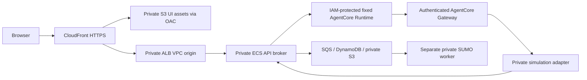

# Public demonstration access

**Migration status:** the private radio relay, firetruck Response Tracker and owned evidence-backed reports are implemented, and the legacy public services and credentials are retired (D55). The controls here describe the current private workspace.

Decision, September 25, 2026: visitors use the integrated workspace without login
and without AWS or provider credentials in JavaScript. Public access authorizes
the documented demonstration operations for an isolated anonymous session. It
does not authorize arbitrary AWS operations or access to other visitors' runs.

## Network and credential boundary

CloudFront is the integrated application's public entry point. S3 blocks public
access and grants the distribution origin access control. ALB is internal; ECS
tasks have no public IP. ALB accepts CloudFront origin traffic and the adapter's
security group. API caching is disabled. The public routing function permits only
`/simulation-api/v1/*`, rewrites it, and overwrites the trusted workspace and
viewer-IP headers. In AWS mode the API serves no interactive docs or schema
routes (`/docs`, `/redoc`, `/openapi.json`); the published contract is
`schemas/simulation/openapi.json`. Outbound, every ECS task may send only HTTPS (TCP 443),
to AWS APIs and the data providers; the API also reaches the private firetruck and
radio services, and the adapter reaches only the ALB.

The API task role invokes only the configured Runtime and its `RELEASE_A` and `RELEASE_B` endpoints.
AgentCore's public service endpoint remains IAM protected; `NetworkMode: PUBLIC`
is not anonymous authorization. Gateway uses its existing machine JWT identity.
The private tool route that the adapter calls requires a short-lived signed context
binding the owner, session, incident, location revision, turn, attempt, and allowed
operations. The workspace API verifies it with the simulation purpose key. The adapter
holds no key: it checks only the shape of the call and forwards the context unchanged.

Every installation bucket's policy also denies object reads, writes and deletes to principals outside the
installation (D52). Its exceptions are the bucket's own roles, the `[aws] operator_role_arns` roles, and AWS
services that have their own Allow: CloudTrail, S3 log delivery and CloudFront's origin access control. The own
roles are the API, worker, firetruck and radio task roles, the artifact collector, the image builder, the
Runtime, the knowledge base and the backend's Runtime build role, which has the fixed name
`<prefix>-backend-runtime-build`. Bucket-level actions stay open, so an operator can always repair a policy. A
new object writer (a CDK `BucketDeployment`, Macie or GuardDuty Malware Protection for S3) needs its role in
that bucket's list first. No Lambda environment holds a credential: the DTN weather Lambda reads its
credentials from the backend API keys secret by ARN (D53). The installation's trail also records object
writes to WorkspaceAssets and BuildSource (D53); a new installation's site bucket from its second release.

Runtime memory access is limited to the stack's memory resource. The existing
Runtime/Gateway `bedrock-agentcore:*` grants are removed. The Gateway role has no
credential-provider access: every target uses the role to invoke its Lambda.
No Gateway/Runtime/Memory administration is granted by these
execution policies. Some existing model/telemetry actions still use resource
wildcards; this is not a claim that every legacy IAM policy has been redesigned.

The radio relay connects only to the private radio service that the API's
`RADIO_SERVICE_URL` names, on one fixed monitor path, with the service key in an
`Authorization` header; it allows plaintext `ws://` only to a `.internal` host.
Visitors cannot supply a host, URL, API key, arbitrary WebSocket command, Runtime
ARN, actor identity, service context, or AWS resource selector. Provider errors
are sanitized and the radio credential is redacted from forwarded messages.
Prerecorded audio may use a short-lived presigned playback URL for that recording;
this URL grants only the object read, not AWS account credentials or permissions.

The optional camera relay calls only the Delphire origin in `[camera] api_base_url` (HTTPS, host only) for the
configured device: `GET /devices/{device_id}/latest` and `GET /images/{id}?type=display`, with the key in an
`Authorization` header and no redirect or proxy. Visitors choose no host, device, camera, endpoint, method or
image type, and receive only images whose IDs are in the broker's cached latest records, as WebP or PNG within
`capacity.camera_image_max_kib`. Once a camera is configured, every visitor with a demo session receives its
device ID, its GPS position to 4 decimals (about 11 m), its wind, humidity, pressure, TVOC and CO2 readings, and the
latest image with its detections. Each API process reuses answers for `cache.camera_cache_seconds`, backs off after
failures, and spends `budgets.camera_calls_per_day` for each Delphire call. The broker refuses any Delphire answer
that contains the key, so the key never reaches the browser, a response or a log. Without a device ID the routes
answer 503 `CAMERA_NOT_CONFIGURED` and the map offers no camera action.

## Anonymous ownership and request validation

`POST /api/v1/demo/session` is intentionally public through the integrated route.
It generates a random 256-bit opaque token. The cookie is `__Host-wildfire-demo`,
Secure, HttpOnly, SameSite=Strict, with Path=/ and no Domain. JSON never contains
the token. Storage keeps its hash, owner identity, and expiry
(`capacity.demo_session_days`, seven days by default); expiry is checked
synchronously rather than waiting for DynamoDB TTL deletion. Every record a
session creates carries the same TTL. One viewer IP may start
`rate_limits.demo_sessions_per_ip_per_day` new sessions per UTC day (429
`DEMO_SESSION_LIMIT`), so minting cookies does not multiply the per-session
limits without bound.

Unsafe requests require the configured HTTPS Origin and same-origin Fetch
Metadata when present. These controls prevent browser cross-site writes. They
are not bot authentication: a programmatic visitor can deliberately initialize
its own session. There is no assumption that a hidden URL, Origin, CORS, WAF,
or a cookie stops all Internet clients from using the permitted public demo.

Every run, draft, incident, artifact, evidence request, cancellation and agent
turn checks ownership server-side. The Runtime conversation key and actor are
derived from that owner; reusing another browser's thread key cannot select its
memory. Guessing an ID or editing local storage does not grant access. Job views
omit owner, lease and outbox fields; the per-phase `timings` map they return
holds only phase names and seconds, never URLs, keys or coordinates.

The API keeps a security event log in its container log (CloudWatch, stream
prefix `Api`): one JSON line with a `security_event` field for every refused
request (401 authentication, 403 authorization or cross-origin write, 404
ownership or unknown ID, 429 limit), every new demo session and every completed
agent tool call (`backend/security_events.py`). A line holds the error
code and status, a server-only reason (for example `other_owner` when a caller
asks for another session's record, `expired_session` or `unknown_session` for a
demo cookie, or the verification failure of a service context), the route
template, the caller's owner digest and the CloudFront request ID (the
`x-edge-request-id` that CloudFront access logs would record; the demo keeps no
edge access logs, an accepted risk under decision D38). It never holds cookies, tokens,
prompts, addresses or request bodies, and the caller still gets the same 404 for
a missing record as for another visitor's. At the edge, WAF keeps per-rule
CloudWatch metrics and a 3-hour sample of the requests each rule matched.

Canonical Pydantic models reject extra fields and unsupported simulator controls.
API request bodies are capped at 160 KiB with a 20-second ingestion deadline by
default (`capacity.request_body_max_kib`, `capacity.request_body_seconds`);
an investigation turn's context is capped at 128 KiB, and the context the API
builds for an updated plan at 192 KiB. WAF blocks known malicious input and
reputation matches and applies two viewer-IP request limits: one for all API
requests and a tighter one for requests that start work (runs, variants, draft
preparation, Traffic Lab runs and lookups, agent turns, radio streams, firetruck
runs and reports), answered with 429 `RATE_LIMITED`. A staging installation's
WAF also blocks every address outside its allowlist. Turn, radio, and job
concurrency/deadline limits protect service availability.

Global daily budgets, shared by all visitors per UTC day, bound billed provider
use: TomTom calls (past it, runs continue with traffic speeds marked
unavailable), AgentCore agent requests, Amazon Location lookups and Delphire camera calls (past them,
429 `DAILY_LIMIT_REACHED`). At most `capacity.active_jobs_all_visitors`
simulation jobs are queued or running across all visitors (503
`SIMULATOR_BUSY` with `Retry-After`), and the study radius is capped. A run uses
at most `simulation.policy_parallelism` processes inside one isolated worker task whose
count, vCPU and memory are fixed at deploy time (`capacity.worker_tasks`, `capacity.worker_vcpu`,
`capacity.worker_memory_gib`), so a visitor cannot make a run use more compute.
Visitors choose study areas, but they cannot fill the worker's scratch disk: it
keeps at most `cache.cached_networks_per_worker` converted road networks in
`cache.cached_network_mib_per_worker` and deletes the least recently used first,
each SUMO log is deleted when its policy ends, and the shared copies under
`network-cache/` expire after `cache.network_cache_days`. Only the worker role
can read or write that prefix, and every reuse checks the network's SHA-256
first ([road-network cache](32-traffic-simulator-architecture.md#road-network-cache)).
Visitors choose coordinates, never URLs: the simulator calls only fixed provider
endpoints, and its public-feed client follows a redirect only to HTTPS addresses
on those fixed provider hosts, so a provider response cannot send the worker or
the API to an internal address
([source adapters](32-traffic-simulator-architecture.md#source-adapters)).
A run whose scenario and frozen inputs match a completed earlier run reuses that
run's result; the reused result names only when it was simulated, never the
earlier run or its owner
([reusing identical runs](32-traffic-simulator-architecture.md#reusing-identical-runs)).
The settings and defaults are listed in
[workspace operations](29-workspace-operations.md#daily-budgets-and-capacity-limits).
These bound cost; they do not guarantee availability: one visitor can still use
up a day's budget for everyone, and none is a guarantee against denial of service.

## Public agent capabilities

The public Investigation supervisor has detection and public-procedure tools, plus communication when a visitor explicitly asks for it.
Detection's model can select only the named Amazon Location geocode and DTN current/forecast
tools plus the existing fixed fire/weather wrapper. Newly added unrelated Gateway
tools do not automatically become available to it.

Public procedure retrieval requires `PublicDemoKnowledgeBaseId`, propagated as
`PUBLIC_DEMO_KNOWLEDGE_BASE_ID`. It must designate a collection intended for public
retrieval. An empty value reports retrieval unavailable. The Runtime has no private-collection
retrieval path and no retrieval cache, and the deployed entry point always selects the public investigation supervisor.

The simulation specialist exposes five operations: preparation, explicit draft
submission, status, evidence, and controlled variant preparation. The service
revalidates record scope and operation authority at each call. A model's answer
cannot manufacture a committed job receipt or enlarge its authorization. Unknown
controls remain unsupported. Reports, dispatch and cloud administration are not
registered public Investigation tools.

Communication drafts guarded English text for one selected owned incident, using only that incident's source records. Code, not the model, translates and records English, Spanish and Hindi with Amazon Translate and Polly, writes the recordings under a private S3 prefix derived from a hash of the verified actor and session, and returns presigned playback links that expire after one hour. Nothing is sent as an alert or to anyone else.

The public header has three numbered steps: 1 · Investigate, 2 · Evacuation & Crew Access and 3 · Response Tracker. The implemented Response Tracker and private radio relay also use owned broker routes; firetruck report generation reads signed retained evidence through a no-tool specialist. These services do not use their former public ALB endpoints.

The managed public SOP collection uses a separate private versioned S3 bucket and S3 Vectors/Bedrock KB. Its reviewed metadata is required by public retrieval, and citation links are restricted to official government hosts. Its contents are official public guidance, not private SOPs. See [PUBLIC_SOP_COLLECTION.md](28-public-sop-collection.md).
## Publication and cutover

Publish only through `bash deployment/deploy-all.sh --apply`, which builds, verifies and publishes the UI with the release it belongs to (`deployment/publish_workspace.py`), not the old Amplify publication command.
It overrides configured Vite variables, blanks browser credentials, builds,
checks publishable assets for known secret values and credential signatures, and
uploads only the checked bytes to private S3. Source maps and unexpected asset
types block publication. Secrets and environment files are never uploaded.
Static analysis and a secret-pattern scan are useful release gates, not a proof
that arbitrary future code cannot leak data.

Publishing this distribution does not revoke credentials embedded in previous
builds or remove old public endpoints; retire those separately.

To close the demo to the public, set `[access] mode = "staging"` with `staging_allowed_cidrs` limited to the operators' networks and run `bash deployment/deploy-all.sh --apply`; WAF then refuses API requests from every other address (the static page still loads). The deployer owns the `PublicDemoMode` parameter and sets it again on every `--apply`, so a manual stack edit does not last. Preserve durable jobs/results during rollback. For access limited to selected people with
no application login, a private network/device access layer is an alternative;
anonymous Internet access necessarily permits unknown visitors to use the
explicitly published capabilities.

## Supply chain and image gate

The deployer enforces the captured [image-scan policy](../deployment/image-scan-policy.json) before it activates each service or Runtime image. The scanner is Amazon ECR BASIC scanning, read with paginated `DescribeImageScanFindings` for each exact digest; the deployer checks every finding and the Critical/High counts. BASIC scanning inventories OS packages only. The source-built SUMO, Xerces, PROJ and FFmpeg are not inventoried: checksums and signatures establish their identity and native tests their behavior, but neither proves the absence of CVEs. No penetration test or application exploitability scanner is part of the gate. Raw findings and applied exceptions are kept in each release's `scan-*.json` receipts.

- SUMO 1.27.1 is compiled from checksum-pinned source. Only headless `sumo`, `netconvert`, data and licenses enter the worker. Checksum-pinned Xerces 3.3.0 disables network access; PROJ 9.9.0 disables CURL, TIFF and unneeded applications. ICU, curl, TIFF, GUI and GDAL are absent from the verified native closure. API verification reuses that artifact; the API runtime has no SUMO binaries.
- Service and Runtime builds use reviewed constraints, locked dependencies, generated schemas and real SDK startup/transport checks. Only active capabilities are composed into the public Runtime.
- Radio consumes fixed operator-configured private S3 recordings. Its FFmpeg 9.0.2 build verifies the upstream signature and source/key checksums, disables autodetection, network and video, and enables only supported audio inputs, output and resampling. Only `ffmpeg`, `ffprobe` and the license enter the runtime. The Linux gate checks supported demuxers, pipe-only protocols, the absence of video decoders and unneeded libraries, actual decoding and HLS rejection.
- The fire-risk image builds Pyrothermel 0.1.4/Behave from the unmodified PyPI source and installs pinned geometry wheels. Its compiler stage is absent from the runtime. Native reference tests verify behavior; BASIC scanning does not inventory this source-built module or establish the absence of native defects.
- ECS tasks use private subnets, no public IPs, non-root users, read-only roots and dropped Linux capabilities. Task definitions supply no authenticated proxy settings.
- Each image repository keeps its newest 10 images and ECR expires the rest (D53). Before any change, the deployer refuses a release whose push would expire an image that a Runtime endpoint or an ECS deployment uses, and it names the newer unused images an operator may delete.

An exception keeps the finding's severity and names the exact component, package, version and CVE, with the owner and an expiry. Only vendor-blocked findings are eligible. The expiry is a project review deadline, not an AWS or vendor mandate: from that date the deployer refuses future activation, while an already running demo keeps running. Unlisted, changed or expired severe findings block the release. An exception is a temporary risk disposition, not remediation or a clean-image claim. Do not transplant an unsupported toolchain, hide package metadata or change a severity to make a scan pass, and claim no blanket exemption for compiler-attributed packages or runtime libraries. Application path restrictions are conditional counterevidence, not patches.

| Finding | Component and remaining uncertainty | Next action |
|---|---|---|
| `CVE-2026-85091` | zlib `1.3.dfsg+really1.3.1-1`: a stalled nonblocking `gzwrite` then `gzprintf`/`gzvprintf`. The advisory's version range differs from the scanner's attribution to the installed package; Debian still lists it unresolved. | Confirm applicability with the vendor before any exception change; otherwise adopt a supported patch and rescan the exact image. |
| `CVE-2026-5435`, `CVE-2026-19499` | Debian trixie glibc `2.41-12+deb13u4`, from the `python:3.14-slim-trixie` base of every image; see the October 15 review below. | Drop the exception once a fixed trixie glibc ships. |

AWS guidance on minimal images, maintained dependencies and measured deployment verification: [ECS security considerations](https://aws.amazon.com/blogs/security/security-considerations-for-running-containers-on-amazon-ecs/) and [ECR BASIC scan coverage](https://docs.aws.amazon.com/AmazonECR/latest/userguide/image-scanning-basic.html).

### Exception re-review

Before the policy expires, the owner re-reviews every exception: drop each one that is fixed or matched no finding in the latest exact-image scans, re-justify the rest, set a new expiry in the policy and record the reason in each exception. Do not extend the date blindly. From the expiry date on, deployer preflight refuses a policy that still lists exceptions, before any build or AWS write, and names this step. Digests and release IDs stay in the release receipts.

## Verification and remaining acceptance

Local tests cover cookie attributes and expiry, forged cookies, cross-session
reads/cancellation, cross-origin writes, oversized input, fixed Runtime identity,
forged authority fields, fixed radio destinations, secret redaction, security
event logging without cookies or tokens, publication gates, public/private KB
separation, and CloudFront header/path handling. Browser
tests exercise the credential-free production build with mocked external services.

Live acceptance verified bounded IAM/Gateway access, private services, direct-origin denial, owned-resource isolation and current provider behavior; repeat the documented gates for each release ([post-deployment tests](29-workspace-operations.md#post-deployment-tests)). No penetration test or deployed
security certification has been completed. A public application cannot honestly
be guaranteed to contain zero vulnerabilities; this design removes identified
exposure paths and provides concrete controls and tests.

References:

- [CloudFront VPC origins](https://docs.aws.amazon.com/AmazonCloudFront/latest/DeveloperGuide/private-content-vpc-origins.html)
- [CloudFront chained-distribution restriction](https://repost.aws/knowledge-center/cloudfront-troubleshoot-403-errors)
- [AgentCore credential and least-privilege guidance](https://docs.aws.amazon.com/bedrock-agentcore/latest/devguide/security-credentials-management.html)
- [AgentCore memory IAM example](https://docs.aws.amazon.com/bedrock-agentcore/latest/devguide/harness-security.html)
