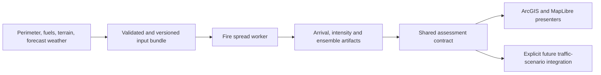

# Wildfire risk map: code review and model assessment

Research date: October 23, 2026.

This is an assessment and proposed direction. No application behavior, contracts, simulations, or deployment configuration were changed. External capabilities were checked in published documentation; no candidate spread engine was installed or benchmarked.

The owner subsequently clarified the demo scope: retain existing Esri fire data and DTN weather, permit an ECS simulator, and add no commercial simulation software. Exposure visualization must draw from each reported fire's latitude/longitude, wherever it is located; chat place names only select discovery. The [wildfire exposure demo plan](wildfire-risk-demo-plan.md), reassessed October 26, starts with weather-informed exposure. The [revised implementation proposal](wildfire-risk-implementation-proposal.md), approved for implementation, separates a top-level modeler/private ECS service from the existing API broker. Free Pyrothermel/Behave and public geographic context remain optional enhancements before a larger ForeFire/landscape worker. These proposals supersede the fixed-region demo and broader engine rollout below.

## Recommendation

Provide coordinate-based proximity/weather exposure context for every valid reported fire. Add a separate **potential fire spread** layer with elapsed-time footprints when weather and fuel/terrain inputs support an engine run. Intensity and ensemble spread likelihood belong to a later, broader forecasting scope rather than the first demo. Provider coverage must not become a regional restriction in the geometry contract.

For the first useful map improvement, combine the reported point or reliably matched WFIGS perimeter with wind-informed exposure bands and explicit weather/source context. Keep calculations in an independently owned modeler using free geometry libraries, reached through the existing broker. Optional Pyrothermel/Behave scenarios can add elapsed-time outlines under documented standard fuel/moisture/slope assumptions, without mandatory landscape rasters. LANDFIRE/LFPS and ForeFire remain a later landscape-aware option; no predefined California landscape is required. ELMFIRE and Pyretechnics are excluded because their current licenses have commercial restrictions. The wider alternatives below remain comparative research; intensity, probabilities and ensembles are outside the first demo.

An arbitrary weighted score of distance, wind speed, humidity, and acreage would still be a heuristic. A wind-stretched ellipse can illustrate a scenario, but does not become a validated prediction just because it looks directional.

## What the code does today

| Component | Implementation | Meaning |
|---|---|---|
| Main map buffers | _ui/src/shared/domain/riskModel.ts:23 (removed in this refactor)_ | Three fixed bands: 0–5, 5–15, and 15–25 km around every supplied location with a truthy `fire` value. |
| Generation | `ui/src/shared/services/agentResponseParser.ts:81` | Buffers are calculated in the browser from returned locations. Weather and forecast data do not drive the geometry. |
| Geometry/rendering | `riskModel.ts:11`; `ui/src/features/map/utils/mapGraphicsLoader.ts:82` | Spherical destination-point calculations using a 6,371 km Earth radius; 72 segments plus an endpoint; annuli use reversed inner rings. ArcGIS draws WGS84 polygons. |
| Labels | `ui/src/features/map/components/MapLegend.tsx:73`; `ui/src/features/map/utils/popupGenerators.ts:249` | The visible layer is already labeled “Illustrative fire buffers”; the popup says it is not a predicted perimeter, calibrated hazard assessment, or evacuation zone. `HIGH/MEDIUM/LOW` remain internal palette keys. |
| Fire selection | `backend/runtime/agents/detection_agent/tools/fire_weather_tool.py:55` | Rank = 60% acreage contribution, capped at 10,000 acres, plus 40% uncontained contribution. Distance breaks ties. Only four fires are returned for map/weather processing. |
| Traffic simulation | `traffic-simulator/traffic_simulator/simulation.py:111` | Zero hazard before an assumed start; then initial radius plus a constant growth rate. Observed weather does not force this growth. |
| Firetruck simulation | `firetruck-simulator/simulator/behaviors.py:107` | Entrapment categories depend on distance thresholds: critical ≤300 ft, high ≤500 ft, medium ≤1,000 ft, otherwise low. The supplied spread-rate argument is unused. |

The main map geometry is reasonable for illustrative distance bands in the California study area. It is not a fire behavior model. A 1-acre fire and a 100,000-acre fire receive identical bands. A nearby location upwind across a fuel break and a farther location downwind on a continuous fuel slope can have the opposite hazard ordering from proximity.

Distance is also measured from a reported point, rather than the nearest observed perimeter. With a large irregular fire, the point can be far from the active front, or a buffer can cover already-burned ground while missing another advancing edge. Acreage alone cannot reconstruct that perimeter.

## Review findings

### 1. Fire selection limits the coverage of the map buffers

`TOP_FIRES_LIMIT = 4` at `fire_weather_tool.py:26`, and `presort_fire_features()` returns only those four. Acreage/containment rank precedes distance. Consequently, four larger distant fires can exclude a smaller fire near the search location. The browser only creates buffers for returned fires.

Furthermore, `totalActiveFires=len(fire_locations)` at line 243 is the selected count, not necessarily all active fires in the search area. Gateway truncation is reported when the upstream 100-record cap is reached, but the local four-fire selection is a separate reduction.

**Suggested change:** separate bounded incident discovery from the expensive weather-enrichment shortlist. Retain all discovered incidents within an explicit display/coverage policy, enrich selected incidents with weather, and report returned count, selected count, upstream truncation, and coverage status separately. For incident assessment, select by stable incident ID rather than silently letting a ranking function determine the assessed fire.

### 2. Missing containment and zero acreage are inconsistent in ranking

`calculate_priority()` preserves zero containment and treats `None` as fully contained for its existing ranking policy. However, the caller at `fire_weather_tool.py:119–120` uses:

```python
acres = attrs.get('DailyAcres') or attrs.get('CalculatedAcres') or 0
containment = attrs.get('PercentContained') or 0
```

The containment expression converts missing data into 0% contained. For 1,000 acres, a read-only reproduction returned **0.06** from `calculate_priority(1000, None)` but **0.46** through `presort_fire_features()` with missing containment. This can alter which four fires reach the map.

The acreage expression similarly replaces a reported `DailyAcres=0` with a nonzero fallback. The result projection at line 193 uses a null check and preserves the reported zero, so ranking can use different acreage from the value displayed.

**Suggested change:** use explicit null handling consistently and retain an “unknown” indicator. Choose and document the ranking treatment of missing measurements; neither unknown containment nor unknown acreage establishes low or high real-world hazard.

### 3. Freshness and incident status do not gate buffer generation

`calculateRiskZones()` checks coordinate validity and the presence of `fire`; it does not inspect `lastUpdated`, `isActive`, or measurement completeness. A supplied `{isActive: false}` record still produces three buffers. The backend’s `isActive` at line 200 is derived from `IncidentTypeCategory == "WF"`—a wildfire incident type does not by itself establish current burning status.

The requested `days` value labels `dataRecency`, but the fire query shown in the detection tool uses `where="1=1"` and does not apply that age filter.

**Suggested change:** preserve incident-type and activity/status as distinct fields, display observation age and unknown status, and require explicit input-freshness rules for any future forecast. Buffer context can remain available for older records if clearly identified.

### 4. Firetruck safety labels overstate what the distance heuristic establishes

The firetruck entrapment function accepts `fire_spread_rate` but never reads it. `escape_route_clear` at `behaviors.py:152` is inferred solely from not being in the critical distance band, rather than route evidence.

**Suggested change:** retain these as explicit synthetic exercise indicators, or replace them with a separate route-exposure assessment using modeled arrival times and road conditions. Fire reaching a route, route traversal time, crew mobility, and safety-zone evidence are different inputs from distance.

### 5. Secondary geometry and presentation issues

- The input contract accepts global coordinates, but longitude is not normalized/split across the antimeridian. A probe at longitude 179.99° produced coordinates up to 180.2148°. Under the clarified coordinate-driven requirement, normalization and correct polygon splitting are acceptance requirements.
- The buffer accepts zero latitude/longitude; `fireGraphics()` at `mapGraphicsLoader.ts:112` rejects them via a truthiness check, so a global map can display a buffer without its fire marker.
- The legend uses kilometers while adjacent incident distances and evacuation UI use U.S. units. The current bands correspond to roughly 3.1, 9.3, and 15.5 miles.
- The test checks one north-facing vertex’s radius. It does not establish correctness for all bearings, holes, antimeridian/polar cases, overlapping incidents, or actual browser rendering.

## Available models and map products

These products answer different questions. An annual probability raster cannot be substituted for an incident’s probability of reaching a location during the next six hours.

| Option | Useful map output | Inputs and limitations | Fit |
|---|---|---|---|
| **Observed WFIGS perimeters** | Latest reported burned extent with capture time | Observation, not forecast; delayed/incomplete coverage and unburned islands need consideration. | Immediate improvement. Already ingested and displayed in the evacuation map. |
| **USFS Wildfire Risk to Communities (WRC)** | Annual burn probability, relative risk to homes, conditional consequences, exposure type | Published landscape baseline, integrating simulation and generalized structure susceptibility. Does not condition on the currently selected fire/weather. | Straightforward optional baseline overlay; downloadable GIS datasets and an ArcGIS viewer. |
| **CAL FIRE Fire Hazard Severity Zones** | Moderate/high/very-high baseline hazard zones | California landscape hazard over a 30–50-year period; explicitly hazard rather than property-specific risk; does not reflect current incident spread. | Useful California context and recognizable categories. |
| **FlamMap BASIC / Minimum Travel Time (MTT)** | Potential spread rate, flame length, intensity; MTT arrival contours and spread paths | Fuels, terrain, moisture and wind. BASIC calculates cellwise potential behavior; MTT adds spread. Constant conditions limit time-varying interpretation. Random-ignition conditional burn probability is a different use from a selected incident run. | Established baseline/scenario comparison. Official desktop application is Windows-only. |
| **FARSITE** | Time-sequenced growth perimeters and fire behavior | Heterogeneous fuels/terrain, moisture and changing weather; initialized from ignition/perimeter. Includes crown-fire and spotting formulations. Requires analyst setup and validation. | Strong established candidate for active-fire scenario forecasting and comparison. |
| **ForeFire** | Time-sequenced propagation fronts and GeoJSON output | Linux/Docker, batch interpreter and Python bindings; Rothermel surface spread; NetCDF landscape and explicit fuel parameter table. GPLv3. Fuel mapping and runtime remain untested. | Current demo recommendation; bounded incident scenarios with automatically acquired/cached landscapes. |
| **ELMFIRE** | Georeferenced arrival time, spread rate, fireline intensity, flame length; ensembles can support spread-likelihood layers | Gridded fuels, terrain, weather, moisture and fire initialization; Linux/MPI/GDAL workflow. Current documentation describes AGPLv3 plus Commons Clause and separate commercial terms. | Comparative research only; excluded from the current plan because of commercial restrictions. |
| **WFDSS FSPro** | Incident-specific probability of fire reaching locations over a defined multiday period | Forecast/historical weather and landscape inputs; runs many possible growth scenarios. WFDSS NextGen has Fire Behavior Analyst roles. Access/export integration must be verified. | Useful agency analysis import/partnership option, not an assumed public compute API. |
| **HDW and WindNinja** | Weather concern and terrain-adjusted wind context | HDW uses weather only; WindNinja supplies spatial wind fields. Neither alone predicts a fire perimeter or structure loss. | Supporting inputs/layers, not replacements for a spread engine. |

Rothermel is an underlying surface-fire spread formulation, used in several engines above, rather than a ready-made incident risk map. A defensible implementation needs propagation across a landscape, weather/fuel conditioning, initialization, and treatment of relevant crown-fire/spotting behavior.

ELMFIRE’s published validation discusses both favorable and unfavorable cases, differences in terrain response, and imperfect perimeter overlap. That supports evaluating it, not declaring it universally more accurate than FARSITE or ready for operational use in this repository.

## Proposed map experience

Use separate selectable layers with clear meanings:

1. **Reported fire extent:** observed perimeter, source, capture time, incomplete/stale status.
2. **Baseline landscape hazard/risk:** WRC or CAL FIRE, named metric and dataset vintage.
3. **Potential spread by time:** model contours at illustrative product horizons such as 1, 3, 6, and 12 hours, anchored to a stated model start time. These horizons are a proposal to validate, not a demonstrated forecast skill.
4. **Spread likelihood by a selected horizon:** an ensemble raster and uncertainty information. Until calibrated, describe percentages as the fraction of modeled scenarios reaching each cell.
5. **Potential impact:** exposed buildings, population, road segments, critical facilities, or utility assets.
6. **Official evacuation information:** a separately sourced authority layer, when available.

Use distinguishable symbology for observed extent, modeled spread, and authority-issued zones. Clicking a modeled area should reveal model/version, run time, observation time, forecast issuance/valid times, forecast horizon, input resolution, assumptions, and unavailable data. Outside the modeled domain or beyond the horizon must mean unknown, not safe.

Arrival time is more informative than a distance band for evacuation/crew-access analysis. A proposed route diagnostic is:

```text
modeled exposure margin =
    modeled fire arrival time at a road location
    - modeled time the traveler passes that location
    - an explicit uncertainty allowance
```

Evaluate it across the whole route and time sequence. It remains a scenario comparison, not proof of safe access; road closures, smoke, spotting, mobility, and observation uncertainty require separate treatment.

## Data and architecture implications

The existing evacuation path already retrieves WFIGS GeoJSON and adds a six-hour capture-freshness flag (`traffic_simulator/feeds.py:143`). `SimulationMap.tsx:284` displays matching source perimeters. This is reusable source evidence, though main-map access and reliable incident matching need a defined contract.

The current “vegetation” service actually supplies **federal land boundaries** (`overlayData.ts:1`). Land ownership does not supply a surface fuel model. County population density is also too coarse to locate neighborhood exposure accurately.

New spread inputs would include:

- Stable incident identifiers, perimeter timestamps, source uncertainty and revision lineage.
- LANDFIRE fuel/landscape products plus elevation/slope/aspect and canopy data where needed. The current Landscape GeoTIFF has eight bands: elevation, slope, aspect, fuel model, canopy cover, canopy height, canopy base height, and canopy bulk density.
- Forecast wind/weather over the study area and time sequence, with correct units and wind “from” conventions. A single current DTN measurement at an incident point is insufficient for a landscape forecast.
- Live/dead fuel moisture or a documented conditioning method; relative humidity alone is not fuel moisture.
- Appropriate building/population/asset geometry for impact analysis; explicit assumptions for suppression and fire barriers.

A proposed dependency flow is:



Implement scientific computation as a deterministic backend worker behind an adapter. The workspace API owns requests, status and canonical assessment metadata; the worker owns engine execution; the UI presents returned evidence; agents explain results.

Define an assessment contract supporting raster products and polygon/contour products, CRS, units, domain, horizon, run identity, source versions/hashes, assumptions, uncertainty, and `unavailable` status. Do not overload the current `RiskZone.riskLevel` palette field with probability or intensity.

Future SUMO consumption should explicitly freeze a selected assessment into new scenario input. Adding an overlay must not silently change existing circular-hazard semantics or invalidate saved run comparisons. Forecast replacement should create a new version, not rewrite historical evidence.

## Suggested sequence and acceptance evidence

**First: improve incident evidence and coverage.** Address selection/count semantics and missing-value ranking; expose observed perimeter/freshness on the main map; add an optional baseline layer. Validate incident matching, source outages, coverage caps, stale data, units, and separate layer meanings.

**Second: benchmark one bounded dynamic-spread integration.** Prepare several historical California cases spanning grass, shrub, timber, wind shifts, and difficult terrain. Initialize from evidence available at the simulated forecast issuance time. Compare with later timestamped perimeters; do not tune and evaluate on the same fires or use future observations as forecast inputs.

Measure perimeter overlap, boundary error, over/underprediction, and arrival-time error where observations support it. Include the current fixed-distance method as a baseline at the same horizons/domain, acknowledging that it does not predict burned extent. Measure cold-start/runtime, input availability, memory and output size. Set acceptance criteria for the intended use before selecting the engine.

**Third: add uncertainty and asset exposure.** Run justified weather/moisture/initialization variations; assess reliability and Brier score for probabilities against a held-out event set with sufficient observations. Distinguish “not reached within this run” from “not exposed.” Validate horizon semantics, overlapping incidents, partial ensemble failures, and asset joins.

True risk combines likelihood with consequences. For asset `a`, a conceptual expected-loss formulation is:

```text
E[loss_a by horizon h] =
    Σ intensity classes i
      P(fire reaches asset a at intensity i by h | current evidence)
      × loss_a(i)
```

That requires asset-specific exposure and vulnerability assumptions. Burn probability, flame length, and population count should remain independently inspectable before deriving any combined score. Do not infer injuries, fatalities, or exact property loss from a spread map.

## Checks performed

| Check | Result | Scope |
|---|---|---|
| `node --test ui/scripts/test/risk-model.test.cjs` | Passed: 1 test | Existing buffer expectations. |
| `.venv/bin/python -m pytest backend/runtime/tests/test_runtime_detection_result.py -q` | Passed: 6 tests and 17 subtests; 2 dependency warnings | Existing detection/ranking/projection checks; provider and runtime dependencies are stubbed. |
| Read-only Node probes using the repository TypeScript loader | Passed | Size/weather/age invariance; inactive records produce buffers; antimeridian longitude issue reproduced. |
| Read-only Python probes of functions extracted from the actual source AST | Passed | Missing-containment mismatch and five discovered features becoming four selected features reproduced. This is function-level evidence, not a live Gateway test. |
| Application build, full quality gate, coverage, browser acceptance, deployment | Not run | No application implementation changed. |
| Candidate engine accuracy, performance, licenses for a selected release, and provider integration | Not validated | Research supports a shortlist; these remain selection work. |

## Research sources

Sources consulted on October 23, 2026:

- [ForeFire: Linux/Docker/Python execution, output formats and GPLv3](https://github.com/forefireAPI/forefire)
- [ForeFire Rothermel and fuel parameterization](https://forefire.readthedocs.io/en/latest/user_guide/fuels_and_models.html)
- [ForeFire governing repository license](https://github.com/forefireAPI/forefire/blob/master/LICENSE)
- [Pyretechnics governing license and commercial restrictions](https://github.com/pyregence/pyretechnics/blob/main/LICENSE.md)
- [USFS FlamMap project: component models, outputs, assumptions and Windows desktop requirement](https://research.fs.usda.gov/firelab/projects/flammap)
- [ELMFIRE user guide: inputs, outputs, execution and current licensing description](https://elmfire.io)
- [ELMFIRE validation: historical comparisons and limitations](https://elmfire.io/validation.html)
- [ELMFIRE governing repository license](https://github.com/lautenberger/elmfire/blob/main/LICENSE.md)
- [LANDFIRE Landscape GeoTIFF: eight input bands and fuel-model choices](https://www.landfire.gov/fuel/landscape)
- [LANDFIRE FAQ: REST API acquisition and asynchronous behavior](https://www.landfire.gov/faqs)
- [LFPS area-of-interest task contract](https://lfps.usgs.gov/arcgis/rest/services/LandfireProductService/GPServer/LandfireProductService)
- [Wildfire Risk to Communities: GIS datasets and metric definitions](https://wildfirerisk.org/download)
- [WRC landscape methods](https://wildfirerisk.org/wp-content/uploads/2024/05/WildfireRiskToCommunities_V2_Methods_Landscape-wideRisk.pdf)
- [CAL FIRE/OSFM Fire Hazard Severity Zones: hazard/risk and time-scale distinction](https://osfm.fire.ca.gov/divisions/community-wildfire-preparedness-and-mitigation/wildfire-preparedness/fire-hazard-severity-zones)
- [WFDSS NextGen user roles, including Fire Behavior Analyst](https://wfdss.firenet.gov/help/Content/30-User_Management/User-Roles.htm)
- [WFDSS NextGen help: FSPro integration status](https://wfdss.firenet.gov/help/Content/Home.htm)
- [NWCG/USFS Wildland Fire Decision Support Tools: interpreting FSPro and near-term fire behavior](https://wfmrda.nwcg.gov/sites/default/files/docs/Line_Officer/Agency_Admin_Toolbox/Wildland_Fire_Decision_Support_Tools.pdf)
- [USFS WindNinja: terrain-dependent wind fields](https://research.fs.usda.gov/firelab/products/dataandtools/windninja)
- [HDW introduction: weather-only inputs and caveats](https://hdwindex.fs2c.usda.gov/abouthdw.html)
- [USFS Wildfire Risk 101: likelihood, intensity, susceptibility and QWRA](https://www.fs.usda.gov/rm/pubs_journals/rmrs/sycu/2024/sycu101_2024_wildfire_risk.pdf)

## Cost and implementation follow-up

Licensing and access rechecked October 23, 2026. Free download, permission to incorporate an engine into a commercial service, and operating cost are distinct questions.

| Item | Fee/access assessment | Development consequence |
|---|---|---|
| WFIGS reported perimeters | Public feed; the existing adapter uses no provider key. | Reuse the integration, retain source attribution, timestamps, completeness and bounded refresh. Public availability is not an uptime guarantee. |
| WRC datasets | Free public resource with downloadable GIS data. | Use as a named baseline product, respecting selected dataset metadata and attribution. Do not present community-scale modeled risk as a calibrated property-specific score. |
| CAL FIRE FHSZ | Public map and GIS products. | Choose the adopted product and correct responsibility-area coverage; retain its version and hazard meaning. |
| LANDFIRE | Public federal input datasets, available for download. | No data purchase is needed for the initial inputs, but preparation, local applicability, storage and refresh still require work. Inspect metadata of the selected layers and any incorporated third-party content. |
| FlamMap, including FARSITE | Official desktop installation is publicly downloadable without a purchase step. | Useful for analyst-generated output and benchmark cases. This does not establish a licensed server SDK or a supported headless Linux interface. Check terms for any library, wrapper or executable actually integrated. |
| WindNinja | Its core license declares the federal-government code public domain; dependencies retain their own terms. | A potential terrain-wind input generator, not a replacement fire-spread engine. |
| ForeFire | GPLv3; no required software purchase or commercial license fee. Redistribution and modifications carry the license's obligations. | Current demo prototype candidate; verify the chosen version, dependencies, fuel mapping and runtime before packaging. |
| ELMFIRE | Current source license is AGPLv3 plus Commons Clause. Listed academic/personal/government/nonprofit uses can use those terms; commercial use requires separate terms and negotiated pricing. | Excluded from the current no-commercial-software demo plan. |
| Pyretechnics | Current community terms permit specified uses without a fee but require separate terms for commercial use. | Excluded from the current plan; source availability is insufficient for the stated licensing constraint. |
| WFDSS FSPro | Government decision-support system with approved application access and roles; no public pay-per-run API was established in this research. | Consider authorized analysis import or agency collaboration; do not make unrestricted FSPro access a product dependency. |

ELMFIRE's current [commercial terms](https://github.com/lautenberger/elmfire/blob/main/COMMERCIAL_LICENSE.md) explicitly list incorporation into a commercial product, paid consulting/modeling, hosted services for paying customers, and revenue-supporting internal use at a for-profit organization. Pricing is negotiated case by case. Current source availability should not be described as permissive open-source licensing.

The implementation would still incur engineering and hosting costs: raster preparation/storage, requests/data transfer, CPU and memory for simulations, and ensemble multiplication of that workload. Existing paid weather/traffic providers retain their costs. I would measure cost per assessment before estimating a monthly bill.

### Delivery slice 1: useful incident context without a spread engine

Deliver a map with:

- The selected incident's reported perimeter and capture time.
- Optional CAL FIRE baseline hazard and WRC baseline risk layers, with distinct legends.
- Existing distance buffers as optional spatial context.
- Explicit missing/stale/partial coverage, and incident counts independent of the weather shortlist.

First fix the ranking's missing-value mismatch, preserve stable provider incident IDs in the detection contract, and join reported points to perimeters by those identifiers. If reliable identifiers are absent, expose an ambiguous match instead of assigning the nearest polygon automatically.

Extend the existing workspace API with a source-context reader. Start from the existing WFIGS feed implementation and move reusable provider acquisition into a narrowly owned adapter when both workflows need it; the API should not instantiate or run SUMO to fetch a perimeter.

For the selected baseline products, use provider services where verified suitable, or preprocess regional data into reusable tiles. Keep small incident geometries as GeoJSON, large landscape rasters as raster tiles. Avoid downloading or converting a statewide raster on each browser request.

Add a proposed `ui/src/features/fire-exposure/` module owning the layer picker, legends, source details and pure presentation projections. ArcGIS and MapLibre each get a small geometry/layer adapter that consumes the same published context. The module must not own simulation accounting or firetruck telemetry.

Acceptance: correct incident association, consistent rendering/units in both maps, visible source vintage, no model jobs on navigation, and meaningful unavailable states during provider failure.

### Delivery slice 2: show completed modeled analyses

Before automating any engine, add a bounded importer for a completed analysis. An analyst could run FlamMap/FARSITE and export GIS outputs; another selected engine can later produce the same canonical artifact.

The importer validates CRS, units, domain, observation/model start time, horizon and output dimensions. It normalizes arrival-time rasters and contours, intensity units, no-data values and source/model metadata. An imported output without adequate lineage remains a labeled scenario and cannot masquerade as a current incident forecast.

Use one proposed `HazardAssessment` result contract:

```text
assessment_id, incident_id, schema_version, status
engine_name, engine_version, model_start_time, horizon_seconds
perimeter_capture_time, weather_issue_time, input_manifest_hash
domain, crs, resolution_m, assumptions, limitations
products: arrival_contours, arrival_raster, intensity_raster
availability and reason codes for each product
```

Do not reuse `RiskZone.riskLevel` as a probability or intensity field. For no-data, outside-domain and not-reached-by-horizon cells, preserve different availability states.

The user sees “Potential spread,” selects a modeled time, and inspects the model and input details. Use the same assessment identity in both map implementations. Keep contour polygons bounded and simplify display geometry without altering analytical artifacts.

Acceptance: known fixture rasters produce correct contours and time labels; CRS/unit errors are rejected; no-data remains unknown; reload restores the same result; metadata can be inspected without requesting another run.

### Delivery slice 3: automate a selected engine

Choose an engine after comparing the installed-release terms, supported execution mode, required inputs, historical performance and resource use. A desktop export workflow can remain useful if the automated-engine choice is unresolved.

Proposed ownership:

| Owner | Responsibility |
|---|---|
| Workspace API hazard routes/application service | Validate incident selection and requests, enforce existing owner access and admission rules, return progress and result references. |
| A narrowly owned `wildfire_hazard` Python package | Input bundle preparation, assessment semantics, engine adapter, output normalization and artifact validation. Domain code does not depend on browser rendering. |
| Fire-spread execution worker | Run the pinned native engine in a bounded subprocess/container and publish validated attempt artifacts. |
| UI wildfire-hazard module and map adapters | Present source context and returned products. |
| Agent runtime | Explain retrieved assessment evidence; does not compute spread geometry or alter scientific output. |

A proposed API could start with:

```text
POST /api/v1/incidents/{incident_id}/hazard-assessments
GET  /api/v1/hazard-assessments/{assessment_id}
GET  /api/v1/hazard-assessments/{assessment_id}/products/{product}
POST /api/v1/hazard-assessments/{assessment_id}/cancel
```

Return an accepted job ID immediately; retain queued/running/completed/failed/cancelled state. Identify reuse by the full input bundle, engine/version, horizon and settings, not by coordinates alone.

Reuse the existing DynamoDB/S3 coordination and artifact patterns only through explicit interfaces. Native fire-model dependencies belong outside the FastAPI runtime image. If independently deployed on AWS, give fire jobs their own queue: placing two different worker types on the existing traffic queue would let the wrong consumer claim work. Reuse lease fencing, request idempotency and attempt-scoped publication behavior without importing scientific fire logic into `traffic_simulator.simulation`.

Start with a single bounded area/horizon and deterministic run. Cache versioned terrain/fuels; refresh and freeze perimeter/weather inputs explicitly. Set cell-count, horizon, subprocess, output-size and concurrency limits before admitting work. Cancelled or lease-lost attempts cannot publish completed results. Retry only appropriate transient failures and retain the input identity.

Regenerate integration contracts with the existing exporter when public models change. Add tests for owner isolation, duplicate delivery, cancellation, partial artifacts, stale inputs, job recovery and data units. Run the required component, quality, build and infrastructure checks for the implementation actually changed. Roll out behind a feature flag; disabling it preserves old assessments and existing maps.

Acceptance: historical held-out comparisons at agreed horizons, reproducible results, measured runtime/cost, coherent source failures, and the same result in local and AWS execution. A numeric accuracy threshold should be agreed for the intended use before evaluation, not selected after observing results.

### Delivery slice 4: uncertainty, impact and explicit traffic integration

Once single-run evidence is satisfactory, add a bounded ensemble over justified weather, moisture and initialization variations. Increase budgets before admitting the extra work, and retain failed-member counts and ensemble design. Assess probability calibration on held-out events; otherwise label percentages as modeled scenario fractions.

Intersect outputs with selected building/population/asset datasets. Publish exposed counts first; derive expected loss only with explicit vulnerability functions and appropriate data. Preserve a separate official-evacuation layer.

Integrate with SUMO through a versioned hazard input artifact containing the selected assessment/hash and documented replay time origin. The current frame contract exposes `hazard_radius_m`; irregular spatial hazards need a new version rather than pretending a radius describes a fire footprint. Compute time-dependent road intersections and exposure through an explicit adapter, with regression tests for closure timing and resident/crew accounting.

A new assessment creates a new scenario/input revision. Historical runs keep their frozen circular assumptions or assessment versions. Forecast simulation time is anchored to `model_start_time`, independently of the UI's traffic replay seconds; their relationship must be recorded rather than assumed.

### Cost controls and principal risks

| Risk | Mitigation and evidence |
|---|---|
| Incorrect incident/perimeter association | Stable IDs, visible ambiguity, source fixtures and missing-identity tests. |
| Stale weather/perimeter makes a current-looking forecast | Preserve issue/capture times, explicit freshness policy and unavailable states. |
| Native runs exhaust public-demo capacity or spend | Bound admission and compute, cap ensembles, cache immutable inputs and measure cost per assessment. |
| Engine choice depends on incompatible license/runtime | Validate the exact release and intended use before automating; retain the engine-independent importer. |
| Forecast changes invalidate policy comparisons | Frozen assessment identity, new input revisions and versioned traffic artifacts. |
| A detailed map implies unsupported accuracy | Historical evaluation, uncertainty displays, honest time/domain limits and separate authority-issued zones. |

Additional references checked for this follow-up:

- [USFS: WRC is a free public resource, with scale/local-calibration limitations](https://www.fs.usda.gov/managing-land/fire/wildfirerisk)
- [Official FlamMap installation/download page](https://research.fs.usda.gov/firelab/products/dataandtools/flammap)
- [FARSITE is incorporated into FlamMap](https://www.frames.gov/catalog/908)
- [WindNinja core license](https://github.com/firelab/windninja/blob/master/LICENSE)
- [WindNinja dependency licenses](https://github.com/firelab/windninja/blob/master/LICENSE-3RD-PARTY)
- [ELMFIRE commercial terms and negotiated pricing](https://github.com/lautenberger/elmfire/blob/main/COMMERCIAL_LICENSE.md)
